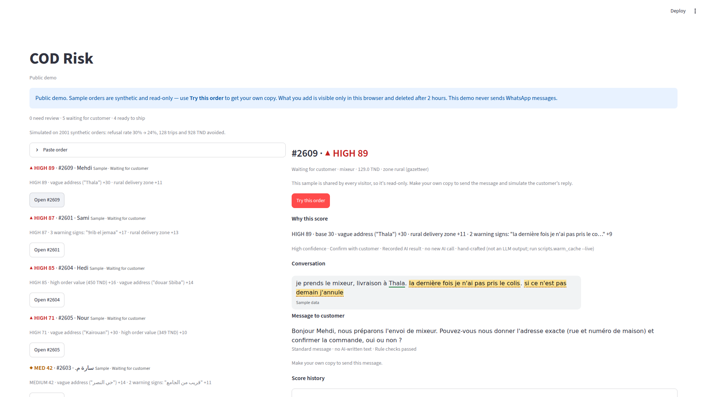
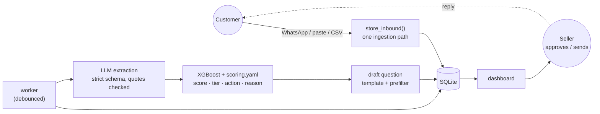
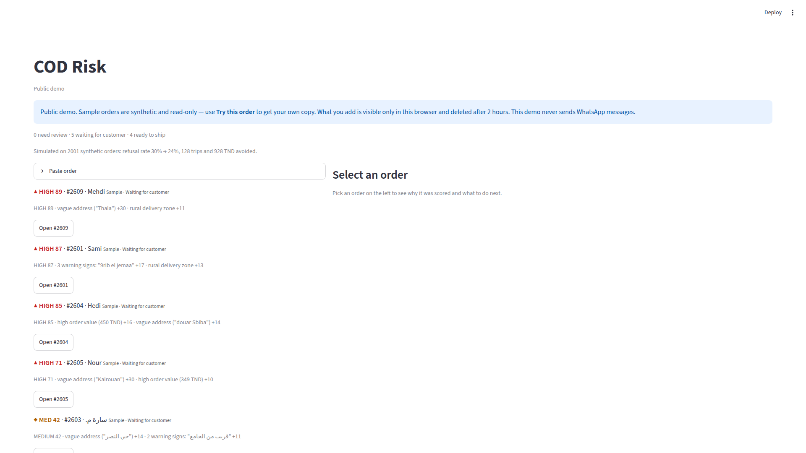
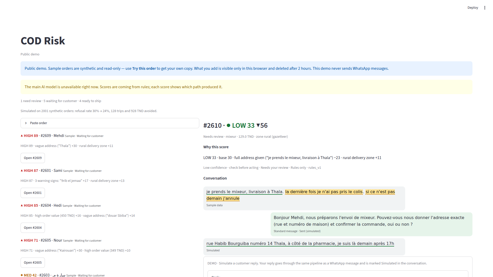
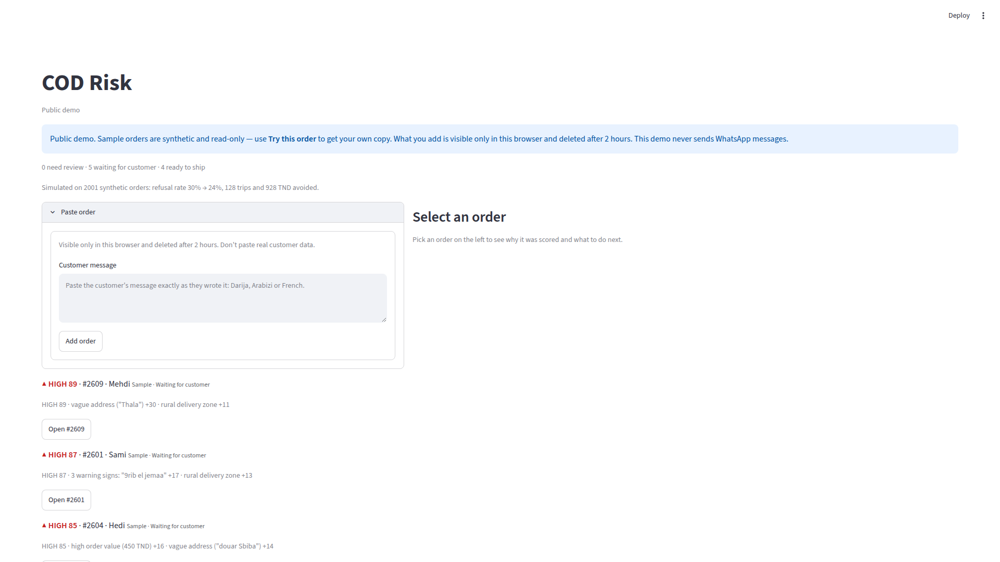
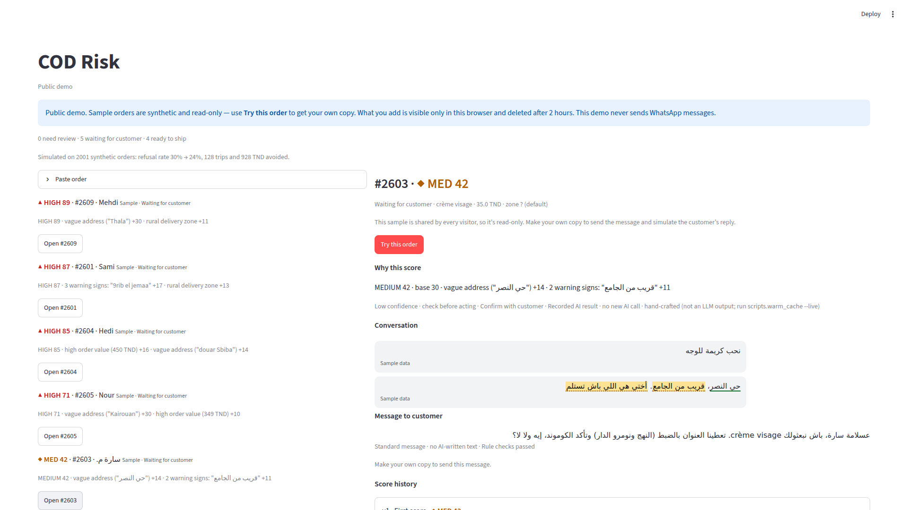
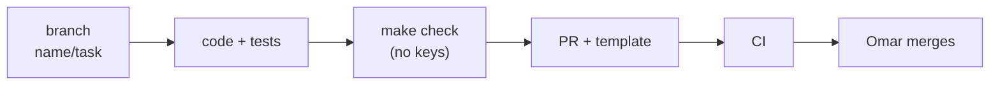

# COD Risk

[](https://github.com/omarbounawarapy/hackathon/actions/workflows/ci.yml)


**Tunisian cash-on-delivery orders get refused at the door. COD Risk reads what the customer wrote, in Darija, Arabizi, Arabic or French, scores the order's refusal risk, explains the score using the customer's own words, and drafts the confirmation question. A person approves every message before it goes out.**

It is for e-commerce sellers and delivery aggregators who pay for every wasted trip. Built by Z-Team for GOMYCODE "Come Build With AI" (27 Sept 2026). All data is synthetic.



> **Hosted demo:** not deployed yet. Run it locally in two commands (below).

## Contents

- [Key features](#key-features)
- [Quick start](#quick-start)
- [How it works](#how-it-works)
- [Use the API](#use-the-api)
- [Screenshots](#screenshots)
- [Project layout](#project-layout)
- [Working on it](#working-on-it)
- [Documentation](#documentation)
- [License](#license)

## Key features

- **Reads messy North African chat.** It handles Arabizi (`9rib el jemaa`), Arabic-script Darija and French, including mixed messages. A strict 12-field JSON schema is filled by an LLM (Groq, with Gemini as a fallback), and a rules extractor takes over when no LLM is available.
- **Code scores, not the LLM.** A monotone XGBoost model on 6 features plus the rules in [`scoring.yaml`](scoring.yaml) produce the score. The tiers are fixed: low < 35 ≤ medium < 65 ≤ high. Each tier maps to an action: ship, confirm, prepay or review.
- **Explains itself with the customer's words.** Each score comes with a reason such as `vague address ("Thala") +30 · rural delivery zone +11`. The quoted phrases are highlighted in the message, and quotes that are not in the original text are dropped.
- **Rescores when the customer replies.** Assessments are versioned. The hero order goes from **HIGH 87 to LOW 16** once the customer gives a full address, and the app shows why.
- **A person sends every message.** Questions are drafted from templates in the customer's language and prefiltered, and nothing is sent without a click. The LLM rewrite and judge step is designed but not built yet.
- **One pipeline for every channel.** The WhatsApp Cloud API webhook (signed, deduplicated), paste, CSV and simulated replies all go through the same ingestion and worker.
- **Safe by default.** The default public mode never sends WhatsApp messages, gives each visitor a sandbox that is deleted after 2 h, and caps LLM spend. Prompt-injection attempts are flagged for review.
- **Runs offline.** With no API keys, the demo uses recorded LLM results plus the rules path. The whole test suite runs without keys in CI.

## Quick start

You need Python 3.11 and `make`.

```bash
git clone https://github.com/omarbounawarapy/hackathon && cd hackathon
make setup      # .venv with pinned dependencies
make up         # API on :8000 + dashboard on :8501, seeded. Ctrl-C stops both
```

Open http://localhost:8501 for the dashboard and http://localhost:8000/docs for the API. No keys are needed: seeded orders use recorded LLM results, and new text goes through the rules extractor.

For live extraction, copy `.env.example` to `.env` and set `GROQ_API_KEY`. `make up` reads `.env`. Gemini is optional: set `GEMINI_API_KEY`, `GEMINI_ENABLED=true` and `GEMINI_MODEL`. Every variable is documented in [`.env.example`](.env.example).

| Command | What it does |
|---|---|
| `make up` | API + dashboard together (`APP_MODE=dev` unless set) |
| `make run` / `make ui` | API only / dashboard only (against `API_BASE_URL`) |
| `make demo` | API in public mode, the way the hosted demo will run |
| `make check` | hygiene + lint + offline tests, no keys (CI runs exactly this) |
| `make docker` | build the production image |
| `make help` | every target |

## How it works



The customer's reply arms a rescore, and the new version shows a reason diff (`v1 87 → v2 16 · full address given −32 · …`). The [architecture doc](docs/architecture.md) has the full set of diagrams: request sequence, scoring pipeline, LLM chain, order state machine, modes and the offline ML pipeline.

## Use the API

The dashboard is one API client; the [`examples/`](examples/) scripts are another. With the API running:

```bash
.venv/bin/python examples/02_customer_reply_rescore.py
```
```
before the reply:
  #2601  v1  HIGH 87  action=confirm  status=awaiting_reply  path=cascade_cache
customer replies: 'ey behi. Douar Ouled Ali, triq el jemaa, dar 14, el bab lazra9 9odem el pharmacie. ...'
after the reply:
  #2601  v2  LOW 16  action=ship  status=ready_to_ship  path=cascade_cache
  diff:   v1 87 → v2 16 · full address given ("Douar Ouled Ali, triq el jemaa, dar 14") −32 · ...
```

Or with `curl`:

```bash
H='X-Visitor-Id: 3f2b8c1e-4a5d-4e6f-9a7b-1c2d3e4f5a6b'   # any uuid v4; required for writes in public mode

# score a pasted message (scored by the worker after a few seconds)
curl -s -X POST localhost:8000/api/orders/ingest -H "$H" -H 'Content-Type: application/json' \
  -d '{"kind":"paste","text":"n7eb el casque, livraison l douar ouled ali 9rib el jemaa","customer_name":"Sami"}'

# the queue, riskiest first
curl -s localhost:8000/api/orders -H "$H"

# a customer reply → a new assessment version
curl -s -X POST localhost:8000/api/conversations/<conversation_id>/simulate-reply -H "$H" \
  -H 'Content-Type: application/json' -d '{"kind":"text","text":"Douar Ouled Ali, triq el jemaa, dar 14"}'
```

| Endpoint | Purpose |
|---|---|
| `GET /api/health` | mode, LLM path, versions, worker state |
| `GET /api/orders` · `GET /api/orders/{id}` | queue · full detail (messages, assessments, drafts, allowed actions) |
| `POST /api/orders/ingest` | paste or CSV |
| `POST /api/conversations/{id}/simulate-reply` | a customer reply (text or location pin) |
| `POST /api/orders/{id}/actions` | `approve`, `request_confirmation`, `cancel`, `ship`, `mark_delivered`, `mark_refused` |
| `POST /api/drafts/{id}/send` | a person sends the drafted message |
| `POST /api/orders/{id}/try` · `/rescore` | copy a sample into your sandbox · force a rescore |
| `GET /api/events` · `GET /api/metrics/impact` | activity log · simulated impact |

Interactive reference: http://localhost:8000/docs. Contract and error codes: [spec 01 §4](docs/council-spec/01-architecture-contracts.md#4-api-contract).

## Screenshots

| | |
|---|---|
|  |  |
| Risk queue | After the customer replies (v2) |
|  |  |
| Paste an order | Arabic-script order |

## Project layout

```
app/          FastAPI backend: api/ db/ ingress/ llm/ extraction/ scoring/ outbound/, worker.py, state.py
dashboard/    Streamlit UI; talks to the API over HTTP only (dashboard/README.md)
ml/           synthetic data generator and XGBoost training (offline)
prompts/ schemas/ scoring.yaml     extraction prompt, JSON schemas, every scoring knob
data/         catalog, zones, phrase banks, message templates, seed conversations, synthetic dataset
models/ reports/                   trained model + card, metrics, screenshots
examples/     runnable API scripts
mocks/        frozen API responses for UI work without a backend
scripts/      warm_cache, dump_mocks, smoke, hygiene, wait_health
tests/        unit/ integration/ e2e/ golden/ fixtures/
docs/         architecture, team guide, council build spec
```

## Working on it

Z-Team members start with the **[team guide](docs/team-guide.md)**. Its diagrams show who owns each folder, where a given change goes, how the lanes connect through contracts, and the route from branch to `main`. Then read [CONTRIBUTING.md](CONTRIBUTING.md). Current progress and open points are in [STATUS.md](STATUS.md).



## Documentation

| Doc | For |
|---|---|
| [docs/architecture.md](docs/architecture.md) | how it works, as diagrams |
| [docs/team-guide.md](docs/team-guide.md) | owners, where to change what, merge flow |
| [examples/](examples/) | runnable API walkthroughs |
| [docs/council-spec/](docs/council-spec/README.md) | the build spec (wins over older docs) |
| [STATUS.md](STATUS.md) | what's built, gates, open points |
| [CHANGELOG.md](CHANGELOG.md) | notable changes |
| [SECURITY.md](SECURITY.md) | reporting problems, safety model |
| `PRD.md`, `SYSTEM_DESIGN.md`, `execution_plan.md`, `hackathon_playbook.md`, `handoff.md`, `FEDI.md` | planning history (superseded where the council spec differs) |

Model numbers come from [`reports/train_metrics.json`](reports/train_metrics.json): holdout AUC 0.784 on synthetic data. [`reports/impact.json`](reports/impact.json) is a simulation on the same synthetic holdout, not a field result.

## License

Copyright © 2026 Z-Team. All rights reserved. The code is public so that it can be read and evaluated; it is not open source. See [LICENSE](LICENSE).
