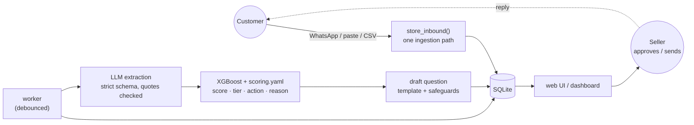

# Wasel


**Tunisian cash-on-delivery orders get refused at the door. Wasel reads what the customer wrote, in Darija, Arabizi, Arabic or French, scores the order's refusal risk, explains the score using the customer's own words, and drafts the confirmation question. A person approves every message before it goes out, unless a classifier clears it and automatic sending is switched on.**

It is built for e-commerce sellers and delivery aggregators who pay for every wasted trip. All data in this repository is synthetic.


## Contents

- [Key features](#key-features)
- [Quick start](#quick-start)
- [How it works](#how-it-works)
- [Use the API](#use-the-api)
- [Project layout](#project-layout)
- [Development](#development)
- [Documentation](#documentation)
- [License](#license)

## Key features

- **Reads messy North African chat.** It handles Arabizi (`9rib el jemaa`), Arabic-script Darija and French, including mixed messages. An LLM (Groq, with Gemini as a fallback) fills a strict 12-field JSON schema, and a rules extractor takes over when no LLM is available.
- **Code scores, not the LLM.** A monotone XGBoost model on six features plus the rules in [`scoring.yaml`](scoring.yaml) produce the score. The tiers are fixed: low < 35 ≤ medium < 65 ≤ high. Each tier maps to an action: ship, confirm, prepay or review.
- **Explains itself with the customer's words.** Each score comes with a reason such as `vague address ("Thala") +30 · rural delivery zone +11`. The quoted phrases are highlighted in the message, and quotes that are not in the original text are dropped.
- **Rescores when the customer replies.** Assessments are versioned. The sample order goes from **HIGH 87 to LOW 16** once the customer gives a full address, and the app shows why.
- **Checks every outgoing message.** Questions are drafted from templates in the customer's language. With `DRAFT_LLM=true` an LLM adapts the wording, then three layers check it: deterministic prefilter rules, a local TF-IDF classifier (no LLM, so it cannot be prompt-injected) and an LLM judge whose verdict is re-checked in code. Anything that fails falls back to the approved template, which a person sends. With the default `auto_send.gate: classifier`, a draft the classifier clears (risk under 10%) goes out automatically once `WA_AUTO_SEND` is on; drafts in the 10–50% review band always wait for a person, and automatic sending never happens in public mode.
- **One pipeline for every channel.** The WhatsApp Cloud API webhook (signed, deduplicated), paste, CSV and simulated replies all go through the same ingestion and worker.
- **Safe by default.** The default public mode never sends WhatsApp messages, gives each visitor a sandbox that is deleted after 2 hours, and caps LLM spend. Prompt-injection attempts are flagged for review.
- **Runs offline.** With no API keys, the app uses recorded LLM results plus the rules path, and the whole test suite runs without keys in CI.

## Quick start

You need Python 3.11 and `make`. The web UI additionally needs Node 22.

```bash
git clone https://github.com/omarbounawarapy/wasel.git && cd wasel
python3.11 -m venv .venv
make setup      # pinned dependencies
make up         # API on :8000 + Streamlit dashboard on :8501, seeded. Ctrl-C stops both
```

Open http://localhost:8501 for the dashboard and http://localhost:8000/docs for the API. No keys are needed: seeded orders use recorded LLM results, and new text goes through the rules extractor.

For the Next.js web UI, run `make web` once and `make demo`; the API then serves it at http://localhost:8000/.

For live extraction, copy `.env.example` to `.env` and set `GROQ_API_KEY`. `make up` reads `.env`. Gemini is optional: set `GEMINI_API_KEY`, `GEMINI_ENABLED=true` and `GEMINI_MODEL`. Every variable is documented in [`.env.example`](.env.example).

| Command | What it does |
|---|---|
| `make up` | API + dashboard together (`APP_MODE=dev` unless set) |
| `make run` / `make ui` | API only / dashboard only (against `API_BASE_URL`) |
| `make web` / `make web-dev` | build the web UI / run it with hot reload on :5173 |
| `make demo` | API in public mode, the way a hosted deployment runs |
| `make check` | hygiene + lint + offline tests + eval gate, no keys (CI runs exactly this) |
| `make serve` / `make tunnel` | host run + publish it on Cloudflare ([deployment guide](docs/deployment.md)) |
| `make help` | every target |

## How it works



The customer's reply arms a rescore, and the new version shows a reason diff (`v1 87 → v2 16 · full address given −32 · …`). The [architecture document](docs/architecture.md) has the full set of diagrams (request sequence, scoring pipeline, LLM chain, order state machine, modes and the offline ML pipeline), the extraction and scoring guarantees, the outbound safeguards and the known limitations.

## Use the API

The web UI and the dashboard are API clients, and so are the [`examples/`](examples/) scripts. With the API running:

```bash
.venv/bin/python examples/02_customer_reply_rescore.py
```
```
before the reply:
  #2601  v1  HIGH 87  action=confirm  status=awaiting_reply  path=cascade_cache
customer replies: 'ey behi. Douar Ouled Ali, triq el jemaa, dar 14, el bab lazra9 9odem el pharmacie. ...'
after the reply:
  #2601  v2  LOW 16  action=ship  status=ready_to_ship  path=cascade_cache
  diff:   v1 87 → v2 16 · full address given ("Douar Ouled Ali, triq el jemaa, dar 14") −32 · ...
```

Or with `curl`:

```bash
H='X-Visitor-Id: 3f2b8c1e-4a5d-4e6f-9a7b-1c2d3e4f5a6b'   # any uuid v4; required for writes in public mode

# score a pasted message (scored by the worker after a few seconds)
curl -s -X POST localhost:8000/api/orders/ingest -H "$H" -H 'Content-Type: application/json' \
  -d '{"kind":"paste","text":"n7eb el casque, livraison l douar ouled ali 9rib el jemaa","customer_name":"Sami"}'

# the queue, riskiest first
curl -s localhost:8000/api/orders -H "$H"

# a customer reply → a new assessment version
curl -s -X POST localhost:8000/api/conversations/<conversation_id>/simulate-reply -H "$H" \
  -H 'Content-Type: application/json' -d '{"kind":"text","text":"Douar Ouled Ali, triq el jemaa, dar 14"}'
```

| Endpoint | Purpose |
|---|---|
| `GET /api/health` | mode, LLM path, versions, worker state |
| `GET /api/orders` · `GET /api/orders/{id}` | queue · full detail (messages, assessments, drafts, allowed actions) |
| `POST /api/orders/ingest` | paste or CSV |
| `POST /api/conversations/{id}/simulate-reply` | a customer reply (text or location pin) |
| `POST /api/orders/{id}/actions` | `approve`, `request_confirmation`, `cancel`, `ship`, `mark_delivered`, `mark_refused` |
| `POST /api/drafts/{id}/send` | a person sends the drafted message |
| `POST /api/orders/{id}/try` · `/rescore` | copy a sample into your sandbox · force a rescore |
| `GET /api/events` · `GET /api/metrics/impact` | activity log · simulated impact |
| `GET /api/monitor` · `/api/traces` · `/api/eval` · `/api/failures` | drift and safety rates · LLM call traces · evaluation report · failure analysis |

Interactive reference: http://localhost:8000/docs (not exposed in public mode). Request and response models are in [`app/api/models.py`](app/api/models.py).

## Project layout

```
app/          FastAPI backend: api/ db/ ingress/ llm/ extraction/ scoring/ outbound/, worker.py, state.py
web/          Next.js web UI (static export served by the API at /)
dashboard/    Streamlit UI; talks to the API over HTTP only (dashboard/README.md)
ml/           synthetic data generator and XGBoost training (offline)
eval/         golden sets, evaluation runner and quality thresholds
failures/     rules-based failure analysis for agent sessions and this app's own data
prompts/ schemas/ scoring.yaml     extraction prompts, JSON schemas, every scoring knob
config/       LLM registry (models, prompt versions) and monitor thresholds
data/         catalog, zones, phrase banks, message templates, seed conversations, synthetic dataset
models/       trained risk model and its card
reports/      training metrics, evaluation reports, simulated impact
examples/     runnable API scripts
mocks/        frozen API responses checked by the API contract test
scripts/      warm_cache, smoke, hygiene, wait_health, vllm_serve, wa_webhook_up, rollback, ...
tests/        unit/ integration/ e2e/ golden/ fixtures/
deploy/       systemd unit for a Linux host
docs/         architecture, deployment, WhatsApp, self-hosted LLM
```

## Development

```bash
make check      # hygiene + ruff + offline tests + eval gate; what CI runs
make test       # offline suite only
make eval       # golden sets gated on eval/thresholds.yaml
make eval-live  # the same sets through a live LLM (needs GROQ_API_KEY)
make train      # retrain the risk model on the synthetic dataset
```

See [CONTRIBUTING.md](CONTRIBUTING.md) for the workflow and house rules.

## Documentation

| Doc | Contents |
|---|---|
| [docs/architecture.md](docs/architecture.md) | system diagrams, extraction and scoring guarantees, outbound safeguards, configuration, limitations |
| [docs/deployment.md](docs/deployment.md) | hosting with `make serve` and a Cloudflare Tunnel, modes, verification, updates |
| [docs/whatsapp.md](docs/whatsapp.md) | connecting the WhatsApp Cloud API webhook, local testing |
| [docs/self-hosted-llm.md](docs/self-hosted-llm.md) | serving the LLM yourself with vLLM |
| [examples/](examples/) | runnable API walkthroughs (customer reply, paste, rescore) |
| [CHANGELOG.md](CHANGELOG.md) | notable changes |
| [SECURITY.md](SECURITY.md) | reporting problems, safety model |

Model numbers come from [`reports/train_metrics.json`](reports/train_metrics.json): holdout AUC 0.784 on synthetic data. [`reports/impact.json`](reports/impact.json) is a simulation on the same synthetic holdout, not a field result.

## License

Copyright © 2026 Z-Team. All rights reserved. The code is public so that it can be read and evaluated; it is not open source. See [LICENSE](LICENSE).
