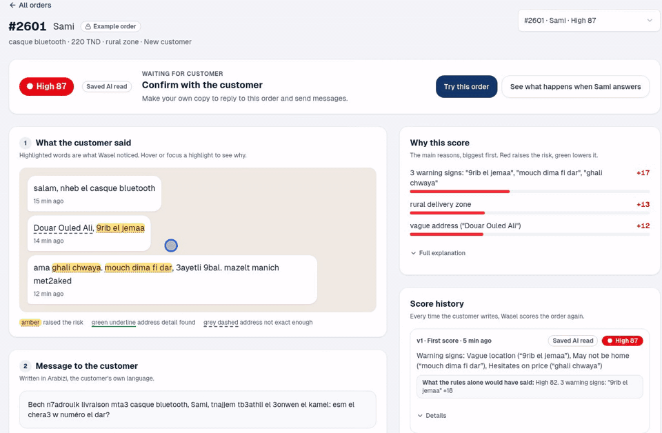
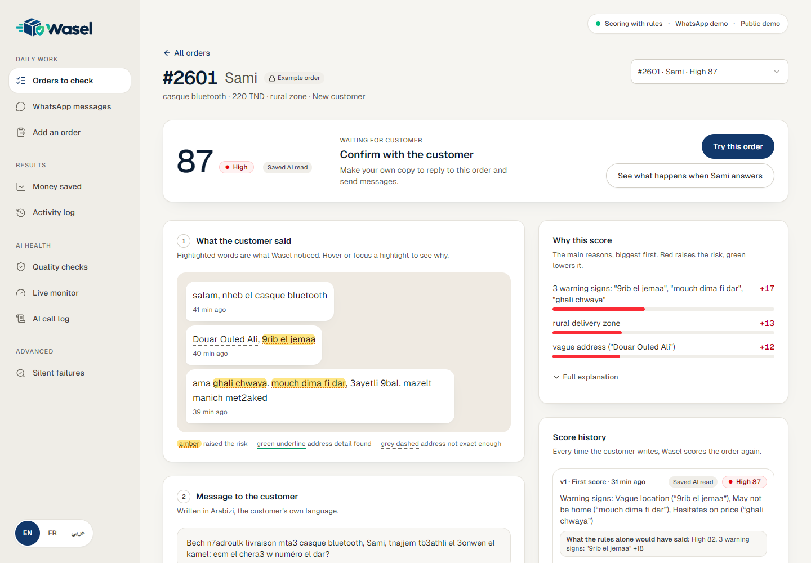
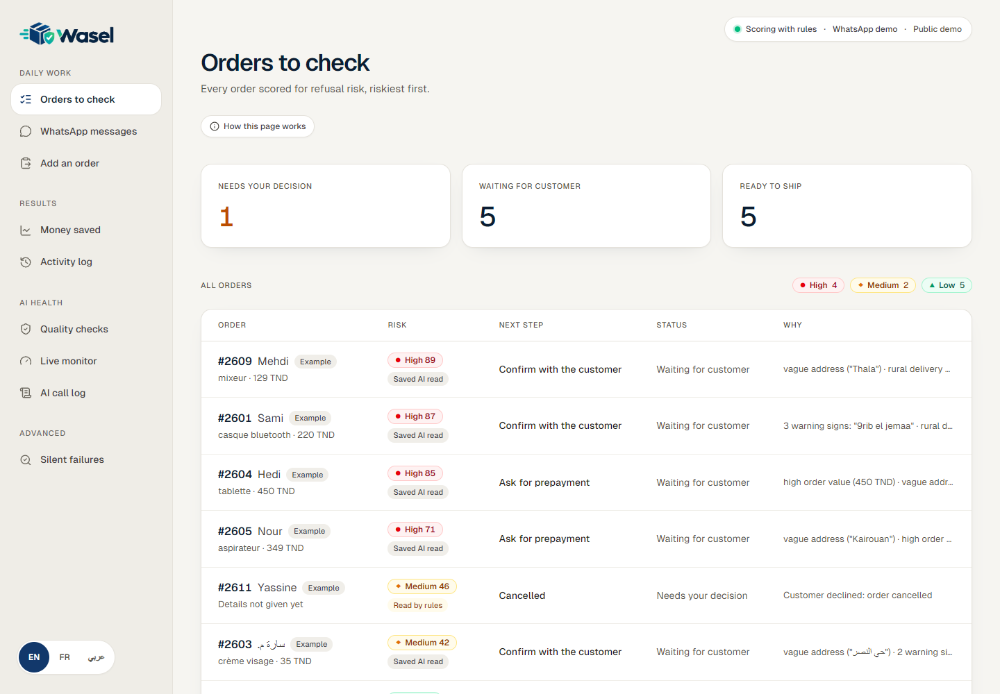
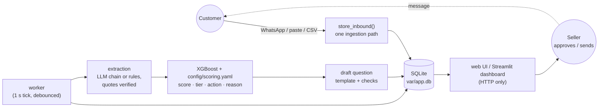

# Wasel

[](https://github.com/omarbounawarapy/wasel/actions/workflows/ci.yml)


Wasel scores the refusal risk of cash-on-delivery (COD) orders that customers place in chat, and helps a seller resolve the risky ones before a courier is sent.

A refused cash-on-delivery parcel costs the seller a wasted trip; one vendor guide puts refusals at 15 to 25 % for Tunisian fashion orders (industry-reported, see [how the problem is sourced](#try-it-in-30-seconds)). Customers order in Tunisian Darija (Arabic script or Arabizi), French or a mix, often with an address like "near the mosque". Wasel reads the conversation, scores the order from 0 to 100, explains the score with the customer's own words, and drafts the one question that would reduce the risk (confirm, complete the address, or pay first). When the customer answers, the order is rescored and the app shows what changed.

**Live demo: [wasel.runs-on.dev](https://wasel.runs-on.dev)** (free tier, may take about a minute to wake). Wasel is built by Z-Team. The source is public so that it can be read and reviewed; it is not open source, see [LICENSE](LICENSE) for what is allowed and [TEAM.md](TEAM.md) for who works on it.

All data in this repository is synthetic. Wasel is a working prototype, not a production-validated risk model: see [limitations](docs/architecture/overview.md#limitations).



## Try it in 30 seconds

1. Open the [live demo](https://wasel.runs-on.dev) (the free tier may take about a minute to wake) or run `make demo` locally; no key is needed.
2. Open order **#2601**. It scores **HIGH 87**: the address is vague and the customer's own words are highlighted as the reasons.
3. Click **Try this order** to copy it into your own sandbox (samples are read-only).
4. Reply as the customer with a full address. The order is rescored to **LOW 16** and the page shows which reasons changed.

Prefer to watch? The [48-second reel](video/renders/wasel-reel.mp4) shows the same flow (GitHub plays it on its own page).

**How the problem is sourced.** Refused cash-on-delivery parcels are the seller's cost. The only refusal range found for Tunisia is an industry-reported figure, a vendor guide's 15 to 25 % for fashion ([Kolonell, 2026](https://kolonell.com/en/blog/tunisia-online-payment-gateway-comparison-2026)); there is no independent national figure, so treat it as indicative.

**How it differs from order-confirmation tools** (UpConfirm, Replyk, Confirmi and similar), which are built around confirming orders. Wasel reads the chat first, scores it with reasons quoted from the customer's own words, and asks one targeted question only where the risk is. A person approves what is sent, and every number comes from code, not from the model.

**Limits.** The data is synthetic and the model measures how well it recovers a hand-written prior, not real refusal behaviour. Darija wording and the French and Arabic interface text have not been checked by a native reader. See [limitations](docs/architecture/overview.md#limitations) and [evaluation](docs/evaluation.md).





## What it does

- **Ingests orders from several channels through one path.** A signed WhatsApp Cloud API webhook, pasted text, CSV upload and simulated replies all end in the same `store_inbound()` function and are scored by the same background worker.
- **Extracts structured facts, then verifies them.** An LLM (Groq, optionally Gemini, or a self-hosted OpenAI-compatible server) fills a 12-field schema. Code then checks every quote against the original text, repairs or drops what does not verify, and falls back to a rules extractor when no LLM is available.
- **Scores in code, not in the LLM.** A monotone XGBoost model on six features, plus rules from [`config/scoring.yaml`](config/scoring.yaml), produces the score, tier (`low` < 35 ≤ `medium` < 65 ≤ `high`), recommended action and a reason string. The LLM never chooses a number.
- **Explains and rescores.** Each score carries a reason such as `vague address ("9rib el jemaa") +17`. A customer reply creates a new assessment version with a reason diff (`v1 87 → v2 16 · full address given −32 · …`).
- **Drafts and checks outgoing messages.** Questions come from approved templates in the customer's language. With `DRAFT_LLM=true` an LLM may reword them, and the rewrite must pass a deterministic prefilter, a local text classifier and an LLM judge. A person sends drafts unless automatic sending is explicitly enabled.
- **Runs safely by default.** With no configuration the app starts in `public` mode: no WhatsApp webhook, no sending, read-only sample orders, per-visitor sandboxes that are purged after two hours, and a daily cap on LLM calls.
- **Measures itself.** An offline evaluation gate (`make eval`) runs on every change, and a monitor endpoint reports drift and safety rates.
- **Runs offline.** With no API keys the app uses recorded extractions for the sample orders and the rules extractor for new text. The whole test suite runs without keys or network.

## How it works



One FastAPI process owns the database and runs the worker. The web UI, the Streamlit dashboard and the example scripts are plain HTTP clients of `/api`. The [architecture overview](docs/architecture/overview.md) and the [order pipeline](docs/architecture/order-pipeline.md) describe each step.

## Technology

| Area | Stack |
|---|---|
| Backend | Python 3.11, FastAPI, Uvicorn, Pydantic v2, SQLite (WAL), `httpx` |
| Scoring | XGBoost (monotone constraints), NumPy, pandas, RapidFuzz (catalog matching) |
| LLM providers | Groq (`openai/gpt-oss-120b`, `openai/gpt-oss-20b`), Gemini (optional), any OpenAI-compatible endpoint such as vLLM |
| Web UI | Next.js 16 static export (React 19, Tailwind 4), served by FastAPI at `/` |
| Dashboard | Streamlit 1.64 |
| Tooling | pytest, ruff, GitHub Actions, GNU Make |
| Hosting | Render free plan for the public demo ([guide](docs/operations/render.md)). Self-hosted: `make serve` and a systemd unit ([guide](docs/operations/deployment.md)) |

**Which hosting target?** Use [Render](docs/operations/render.md) (free plan) for a public demo, `make serve` ([deployment](docs/operations/deployment.md)) for a host you control.

## Quick start

You need Python 3.11 and `make`. The web UI build also needs Node 22.

```bash
git clone https://github.com/omarbounawarapy/wasel.git && cd wasel
python3.11 -m venv .venv
make setup      # pinned dependencies + the wasel package (editable)
make up         # the seller UI and API on :8000, freshly seeded (builds the UI on first run). Ctrl-C stops it
```

Open http://localhost:8000 for the seller UI and http://localhost:8000/docs for the interactive API reference. No keys are needed: the sample orders use recorded extractions and new text goes through the rules extractor.

For the analyst view (Streamlit operator tools, not the seller UI), keep `make up` running and run `make ui` in a second terminal, then open http://localhost:8501.

To use a live LLM, copy `.env.example` to `.env`, set `GROQ_API_KEY`, and start with `make up`, `make run` or `make serve` from the repository root (the LLM layer reads `.env` itself). See [configuration](docs/configuration/README.md) for every setting and [getting started](docs/getting-started.md) for the full walkthrough, health checks and first-run problems.

To verify your checkout:

```bash
make check      # hygiene + ruff + offline tests + evaluation gate; needs no keys, about a minute
```

`make help` lists every target; [development/commands.md](docs/development/commands.md) explains each one, including which ones overwrite committed files.

## Documentation

| Read this | To learn |
|---|---|
| [Getting started](docs/getting-started.md) | install, run, health checks, first-run problems |
| [Architecture overview](docs/architecture/overview.md) | components, boundaries, modes, limitations |
| [Order pipeline](docs/architecture/order-pipeline.md) | what happens to a message, scoring, order states |
| [Data model](docs/architecture/data-model.md) | entities, tables, lifecycle, invariants |
| [Configuration](docs/configuration/README.md) | environment variables, `scoring.yaml`, LLM registry, prompts, schemas |
| [Subsystems](docs/subsystems/) | extraction, scoring, outbound drafts, LLM layer, WhatsApp, monitoring, failure analysis |
| [Machine learning](docs/machine-learning.md) | synthetic data, features, training, model card, retraining |
| [Evaluation](docs/evaluation.md) | golden sets, gate thresholds, how to read a failure |
| [API](docs/api.md) | endpoints, auth, errors, public-mode rules |
| [Web UI and dashboard](docs/interfaces.md) | the two front ends and how they reach the backend |
| [Data directory](docs/data.md) | every file under `data/`, what produces it, whether to edit it |
| [Commands](docs/development/commands.md), [testing](docs/development/testing.md), [extending](docs/development/extending.md) | day-to-day development |
| [Deployment](docs/operations/deployment.md), [Render](docs/operations/render.md), [self-hosted LLM](docs/operations/self-hosted-llm.md), [troubleshooting](docs/operations/troubleshooting.md) | running it for other people |
| [Team](TEAM.md), [Team workflow](docs/development/workflow.md), [Security](SECURITY.md), [Changelog](CHANGELOG.md) | roles, working rules, policy and history |

The full index with reading order is in [docs/README.md](docs/README.md).

## Repository layout

```
src/wasel/      the Python package (installed editable by `make setup`)
  api/ db/ ingress/ extraction/ scoring/ outbound/ llm/    HTTP layer, SQLite, webhook, verification, scoring, drafts, providers
  ml/ evaluation/ failures/ monitor.py                     training, golden-set runner, failure analyzer, drift monitor
  main.py worker.py settings.py state.py                   app factory, background worker, settings, order state machine
web/            Next.js UI (static export served by the API)
dashboard/      Streamlit UI (HTTP client only)
config/         scoring.yaml, llm.yaml, monitor.yaml, eval.yaml, prompts/, schemas/
data/           catalog, zones, phrase banks, templates, seed/, synthetic dataset, eval/, reports/
models/         trained risk model and its card
tests/          unit/ integration/ e2e/, fixtures/, golden/
scripts/        data/ ops/ dev/ helper scripts (see docs/development/commands.md)
examples/       runnable API scripts
deploy/         systemd unit; render/ = Dockerfile and hashed lock for the Render image
docs/           documentation
```

## Contact

Questions, feedback or a data request about the demo: **contact@wasel.runs-on.dev**. A security problem: the same address, see [SECURITY.md](SECURITY.md). The site's [privacy page](https://wasel.runs-on.dev/privacy/) says what the demo stores.

## License

Copyright © 2026 Z-Team. All rights reserved. The source is public for viewing but is not open source. Z-Team members may use and modify it; anyone may view it on GitHub and fork it there; any other use needs Z-Team's written permission. See [LICENSE](LICENSE) and [TEAM.md](TEAM.md).
