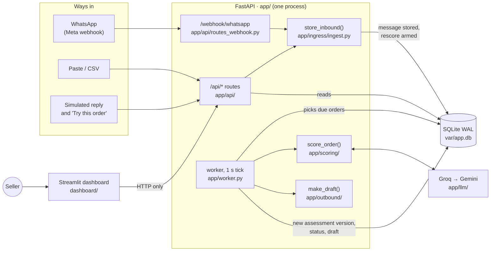
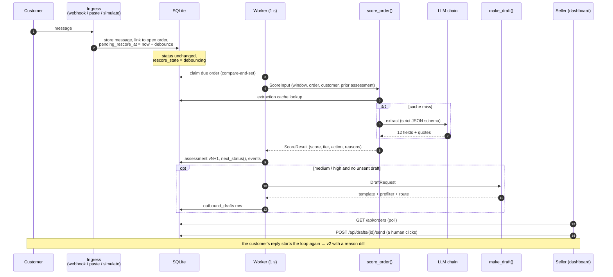
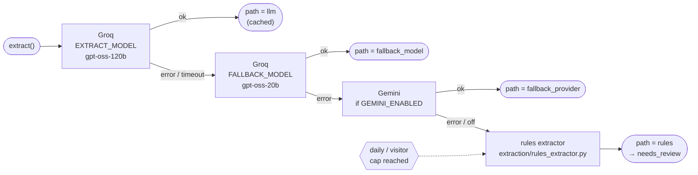
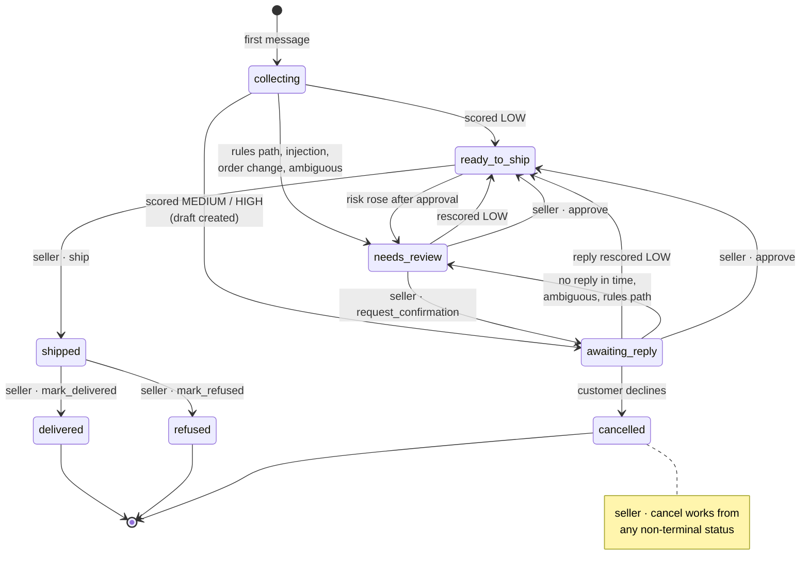
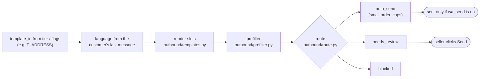
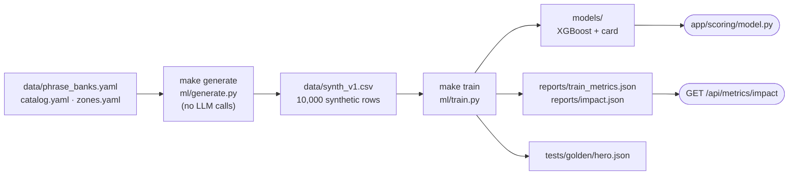

# Architecture

How the code is laid out and how an order moves through it. The diagrams follow the code on `main`. Where they simplify, the spec section that holds the full detail is linked. For who works where, see the [team guide](team-guide.md).

- [1. The system on one page](#1-the-system-on-one-page)
- [2. One message, end to end](#2-one-message-end-to-end)
- [3. Inside `score_order`](#3-inside-score_order)
- [4. The LLM chain](#4-the-llm-chain)
- [5. Order lifecycle](#5-order-lifecycle)
- [6. Drafting the customer message](#6-drafting-the-customer-message)
- [7. Modes](#7-modes)
- [8. Offline ML pipeline](#8-offline-ml-pipeline)

## 1. The system on one page

A single FastAPI process owns the SQLite database. Every way an order can arrive goes through the same `store_inbound()`, and the background worker does all the scoring. The dashboard only talks HTTP.

Three rules hold everywhere:

- **FastAPI is the only writer.** The dashboard never touches the database.
- **One ingestion path.** WhatsApp, paste, CSV, simulated replies and seeding all call `store_inbound()`, so each fallback runs the real pipeline.
- **The LLM extracts, code decides.** The LLM fills a strict 12-field schema and quotes the customer. The XGBoost model and the rules in `scoring.yaml` produce every number.

## 2. One message, end to end

A new message arms a debounced rescore (a newer message pushes it back). The worker claims the order, scores it, saves a new assessment version, moves the order through the state machine and, when a question is needed, drafts one. A person sends it.

Spec: [01 §5.1–5.3](council-spec/01-architecture-contracts.md#5-order-state-machine).

## 3. Inside `score_order`

`app/scoring/score_order.py` is a pure function of its input plus injected seams (cache, LLM client, usage meter, config). That is what lets the tests run it without a network.

Tiers are fixed cut-offs from `scoring.yaml`: **low < 35 ≤ medium < 65 ≤ high**. Spec: [02 LLM layer](council-spec/02-llm-layer.md), [03 Data + ML](council-spec/03-data-ml.md).

## 4. The LLM chain

`ChainClient` in `app/llm/client.py` tries each step once (no retries) and records every attempt. A daily cap or a failure never becomes an HTTP error; the order drops to the rules path and goes to review.

`LLM_MODE` swaps the chain for tests and drills: `live`, `replay`, `fail_primary`, `fail_groq`, `fail_all`. Only `path = llm` results are cached; fallbacks never are.

## 5. Order lifecycle

Statuses come from `next_status()` (automatic, after each scoring) and `ACTIONS` (seller clicks), both in `app/state.py`. An action that is not allowed from the current status returns `409 INVALID_TRANSITION` with the allowed list.

A message on a terminal order opens a new order. The full first-match-wins table is in [01 §5.2](council-spec/01-architecture-contracts.md#5-order-state-machine).

## 6. Drafting the customer message

Today the draft is a static template (`data/templates/outbound.yaml`) in the customer's language, checked by a prefilter and routed. The LLM rewrite and judge (spec item S-3, `DRAFT_LLM`) are **not built**: the prompts and schemas exist, the code path raises if enabled.

## 7. Modes

`APP_MODE` decides what is safe to expose. Missing or unknown means `public`.

| | `dev` | `event` | `public` (default) |
|---|---|---|---|
| WhatsApp send | `WA_SEND_ENABLED` | `WA_SEND_ENABLED` | forced off |
| Webhook mounted | if enabled and secrets set | same | never |
| Who sees what | everything | everything | seeded rows + your own sandbox (`X-Visitor-Id`) |
| Seeded rows writable | yes | yes | no (409, use "Try this order") |
| No-reply timeout | on | on | off |
| Sandbox purge | off | off | every 10 min, 2 h TTL |
| `SEED_ON_BOOT=auto` | if empty | if empty | always (fresh DB) |

`GET /api/health` always reports `mode`, `wa_send` and `webhook`, and CI checks that the Docker image boots as public with both off. Spec: [01 §6](council-spec/01-architecture-contracts.md#6-deploy-topology-modes-and-the-switch-runbook), [04 Security](council-spec/04-security-public-mode.md).

## 8. Offline ML pipeline

Nothing here runs at request time. The app only loads `models/` and reads `reports/impact.json`.

All data is synthetic. Holdout AUC is 0.784 (`reports/train_metrics.json`), and the impact figures are simulated from the same holdout.
