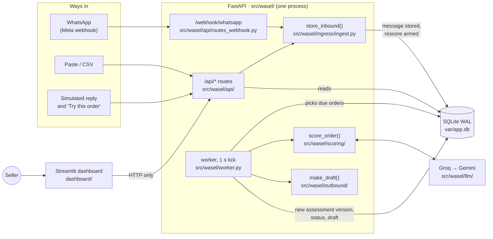
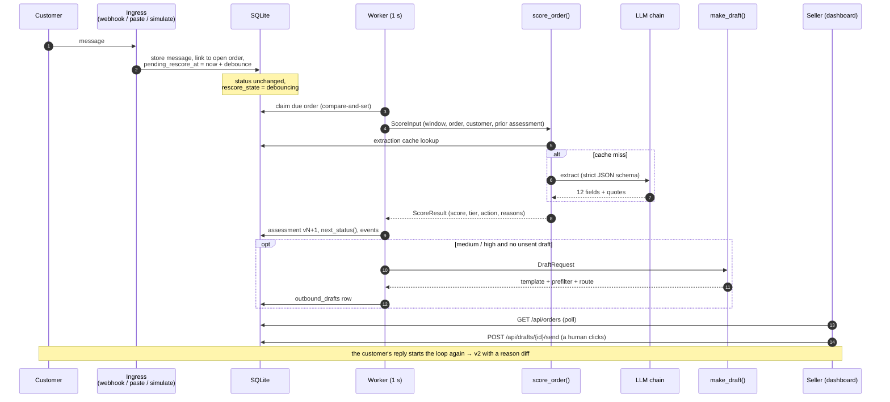
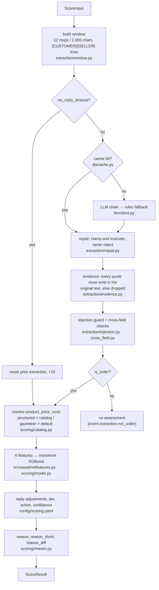
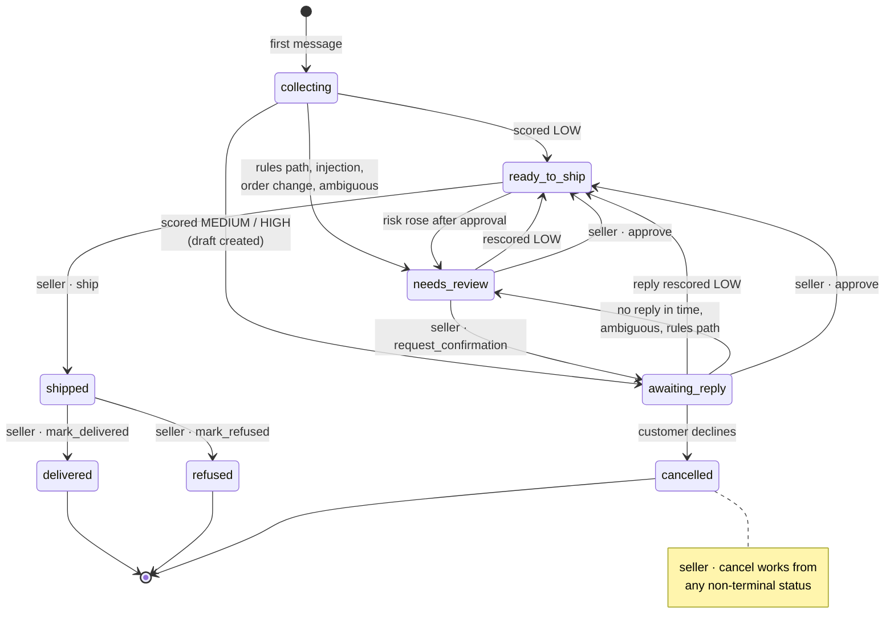
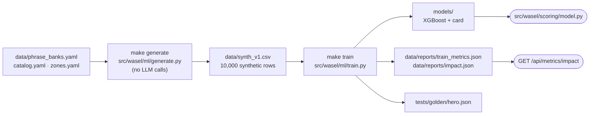

# Architecture

How the code is laid out and how an order moves through it. The diagrams follow the code on `main`; the sections after them describe the guarantees the pipeline enforces, the model, the safeguards, the configuration and the known limitations.

- [1. The system on one page](#1-the-system-on-one-page)
- [2. One message, end to end](#2-one-message-end-to-end)
- [3. Inside `score_order`](#3-inside-score_order)
- [4. The LLM chain](#4-the-llm-chain)
- [5. Order lifecycle](#5-order-lifecycle)
- [6. Drafting the customer message](#6-drafting-the-customer-message)
- [7. Modes](#7-modes)
- [8. Offline ML pipeline](#8-offline-ml-pipeline)
- [9. Extraction guarantees](#9-extraction-guarantees)
- [10. Scoring model and decision rules](#10-scoring-model-and-decision-rules)
- [11. Outbound message safeguards](#11-outbound-message-safeguards)
- [12. Cost and rate controls](#12-cost-and-rate-controls)
- [13. Monitoring and evaluation](#13-monitoring-and-evaluation)
- [14. Data handling](#14-data-handling)
- [15. Configuration](#15-configuration)
- [16. Limitations](#16-limitations)

## 1. The system on one page

A single FastAPI process owns the SQLite database. Every way an order can arrive goes through the same `store_inbound()`, and the background worker does all the scoring. The dashboard only talks HTTP.

Three rules hold everywhere:

- **FastAPI is the only writer.** The dashboard never touches the database.
- **One ingestion path.** WhatsApp, paste, CSV, simulated replies and seeding all call `store_inbound()`, so each fallback runs the real pipeline.
- **The LLM extracts, code decides.** The LLM fills a strict 12-field schema and quotes the customer. The XGBoost model and the rules in `config/scoring.yaml` produce every number.

## 2. One message, end to end

A new message arms a debounced rescore (a newer message pushes it back). The worker claims the order, scores it, saves a new assessment version, moves the order through the state machine and, when a question is needed, drafts one. A person sends it.

## 3. Inside `score_order`

`src/wasel/scoring/score_order.py` is a pure function of its input plus injected seams (cache, LLM client, usage meter, config). That is what lets the tests run it without a network.

Tiers are fixed cut-offs from `config/scoring.yaml`: **low < 35 ≤ medium < 65 ≤ high**.

## 4. The LLM chain

`ChainClient` in `src/wasel/llm/client.py` tries each step once (no retries) and records every attempt. A daily cap or a failure never becomes an HTTP error; the order drops to the rules path and goes to review.

`LLM_MODE` swaps the chain for tests and drills: `live`, `replay`, `fail_primary`, `fail_groq`, `fail_all`. Only `path = llm` results are cached; fallbacks never are.

## 5. Order lifecycle

Statuses come from `next_status()` (automatic, after each scoring) and `ACTIONS` (seller clicks), both in `src/wasel/state.py`. An action that is not allowed from the current status returns `409 INVALID_TRANSITION` with the allowed list.

A message on a terminal order opens a new order. The transition rules are evaluated first-match-wins in `src/wasel/state.py`.

## 6. Drafting the customer message

By default the draft is a static template (`data/templates/outbound.yaml`) in the customer's language, checked by a prefilter and routed. With `DRAFT_LLM=true` an LLM first rewrites the template and the rewrite must pass three layers (see [section 11](#11-outbound-message-safeguards)); anything that fails falls back to the template.

## 7. Modes

`APP_MODE` decides what is safe to expose. Missing or unknown means `public`. `event` is the mode for a live deployment connected to WhatsApp: real rows, a higher LLM cap, no visitor isolation.

| | `dev` | `event` | `public` (default) |
|---|---|---|---|
| WhatsApp send | `WA_SEND_ENABLED` | `WA_SEND_ENABLED` | forced off |
| Webhook mounted | if enabled and secrets set | same | never |
| Who sees what | everything | everything | seeded rows + your own sandbox (`X-Visitor-Id`) |
| Seeded rows writable | yes | yes | no (409, use "Try this order") |
| No-reply timeout | on | on | off |
| Sandbox purge | off | off | every 10 min, 2 h TTL |
| Daily live-LLM cap | none | 300 | 80 |
| `SEED_ON_BOOT=auto` | if empty | if empty | always (fresh DB) |

`GET /api/health` always reports `mode`, `wa_send` and `webhook`, and CI checks that a freshly started server reports `public` with both off.

## 8. Offline ML pipeline

Nothing here runs at request time. The app only loads `models/` and reads `data/reports/impact.json`.

All data is synthetic. Holdout AUC is 0.784 (`data/reports/train_metrics.json`), and the impact figures are simulated from the same holdout.

## 9. Extraction guarantees

The LLM fills a strict 12-field JSON schema (`config/schemas/order_extraction_v1.json`): `is_order`, `is_order_change`, `product_quote`, `quantity`, `address_quotes`, `address_level`, `has_landmark`, `has_building_or_apt`, `red_flags` (each with the customer's evidence quote and a code), `tone`, `confirmation`, `language` and `clarity`. Its output then passes a deterministic pipeline before anything is scored:

1. **Repair** (`extraction/repair.py`) clamps and truncates out-of-range values instead of rejecting the response.
2. **Evidence check** (`extraction/evidence.py`) requires every quote to be a substring of the customer's text after normalization (NFKC, casefold, Arabic diacritics and tatweel stripped, letter variants unified). A quote that is not found is dropped and counted; if every address quote drops, `address_level` becomes `none`.
3. **Cross-field rules** (`extraction/cross_field.py`) undo contradictions: `is_order=false` clears the other fields, `exact` without a building or apartment cue is downgraded, a `confirmation` without a preceding outbound message resets to `none`. A location pin forces `exact`.
4. **Injection handling.** The prompt tells the model that customer text is data. Independently, `extraction/injection.py` matches a phrase lexicon (`config/scoring.yaml` › `lexicons.injection`) on a normalized view, control characters are stripped, input size is capped, and a suspected injection sends the order to human review while it is still scored.

## 10. Scoring model and decision rules

`src/wasel/ml/features.py` turns the validated extraction and the order record into six features; a monotone XGBoost model (`models/risk_xgb_v1.json`, card in `models/risk_xgb_v1.card.json`) maps them to a refusal probability, and `score = 100 × probability` plus the reply adjustments in `config/scoring.yaml`.

| Feature | Meaning | Monotone |
|---|---|---|
| `address_specificity` | 0 none · 0.25 city · 0.5 area or landmark · 0.75 street and landmark · 1.0 exact (better address → lower risk) | decreasing |
| `red_flag_count` | number of red flags whose evidence quote was verified | increasing |
| `tone_score` | positive → negative | increasing |
| `price_tnd` | catalog price or the seller-entered value | increasing |
| `zone_encoded` | urban / suburban / rural, from the gazetteer in `data/zones.yaml` | increasing |
| `customer_refusal_rate` | smoothed refusal rate of this customer's earlier orders (0.30 for a new customer) | increasing |

Monotone constraints make the model's behaviour auditable: a more specific address can never raise the score. Per-feature SHAP contributions are converted into points and the strings in `reason` (`src/wasel/scoring/reason.py`); every quoted phrase in a reason is verified against the original text, and no LLM writes a reason.

Tiers and actions are fixed cut-offs in `config/scoring.yaml`:

| Score | Tier | Action |
|---|---|---|
| < 35 | low | ship |
| 35 – 64 | medium | confirm with the customer |
| ≥ 65 | high | prepay if the order is at least 250 TND, otherwise confirm |
| no valid extraction, injection, ambiguity | – | review |

`confidence` is `low` (and the order goes to a person, never to auto-send) if any of these holds: the rules extractor or a fallback model produced the extraction, the LLM cap was reached, the message is unclear, more than one quote was dropped, an injection is suspected, the product is not in the catalog, an input had to be imputed, or the score is within 10 points of a tier boundary. Confidence is an operational rule, not a calibrated probability.

Training data is synthetic: `src/wasel/ml/generate.py` produces 10,000 rows whose refusal labels are drawn from a documented prior, so the reported holdout AUC (0.784) and calibration error (2.4 points) measure how well the model recovers that prior, not real-world refusal behaviour. Retrain on real outcomes before relying on the numbers.

## 11. Outbound message safeguards

Every outbound message is checked before it can leave the system. With `DRAFT_LLM=true` an LLM rewrites the approved template, and the rewrite must pass, cheapest layer first:

1. **Prefilter** (`outbound/prefilter.py`): deterministic rules. Required slot values must appear verbatim, no numbers other than price and quantity, no URLs or phone numbers, no payment or credential terms, no discount or delivery promises that are not in the order, length limit.
2. **Guard classifier** (`outbound/guard_clf.py`): a local TF-IDF character n-gram classifier with no LLM, so it cannot be prompt-injected. It returns `send` (risk below `classifier_hold_at`, 10%), `review` (10–50%: waits for the seller) or `block` (above `classifier_block_at`, 50%: the rewrite is discarded and the template is used).
3. **LLM judge** (`outbound/judge.py`): checks that every claim is supported by the order, the language and tone match, nothing overreaches (discounts, payment requests, delivery commitments) and the expected number of questions is asked. Its approval is recomputed in code from the returned fields, and a rejection triggers one regeneration with the reason before falling back to the template. The judge never sees customer text.

Each layer can only remove approval. If the judge is unavailable the draft goes to review, never to auto-send.

`outbound/route.py` then decides the route: `auto_send`, `needs_review` or `blocked`. Sending without a click requires all of: `WA_AUTO_SEND` on, not public mode, `auto_send.gate` satisfied (`classifier` by default; `judge` additionally requires the judge's approval), prefilter passed, `confidence` high, price at most 150 TND, at most 2 automatic messages per order, and inside WhatsApp's 24-hour window. Static templates always wait for a person. On channels other than WhatsApp a system send is recorded as simulated.

## 12. Cost and rate controls

- The extraction prompt prefix (system prompt plus few-shot examples) is stable so provider-side prompt caching applies.
- Extraction results are cached by input hash (rendered window, model and prompt version); repeated runs of the same conversation make no LLM call.
- Bursts of messages share one rescore through the debounce (15 s in production, 4 s when `DEMO_MODE=true`).
- The chain never retries: each provider is tried once, then the next step is used.
- Daily and per-visitor caps (`LIVE_LLM_DAILY_CAP`, `VISITOR_LLM_CAP_10MIN`, `VISITOR_LLM_CAP_DAY`) fall back to the rules extractor and never produce an HTTP error. Public mode defaults to 80 live calls per day.

## 13. Monitoring and evaluation

- `GET /api/monitor` reports drift and safety rates (fallback rate, judge rejection and ungrounded rates, injection rate) computed from stored traces and assessments, with thresholds in `config/monitor.yaml`. It never returns customer text. `GET /api/traces` lists recent LLM calls.
- `GET /api/failures` runs the rules-based failure analyzer in `src/wasel/failures/` over recorded agent sessions and this app's own database.
- `make eval` runs 476 golden cases (extraction, outbound drafts, injection) offline and gates them on `config/eval.yaml`; it is part of `make check`. `make eval-live` runs the same sets through a real LLM and writes `data/reports/eval_live.json`.
- LLM roles (`extract`, `rewrite`, `judge`) and their prompt versions are registered in `config/llm.yaml`; `python scripts/ops/rollback.py <role> <version>` reverts one. Prompt files are locked by sha256 in `config/prompts/VERSIONS`, so editing a prompt requires a version bump.

## 14. Data handling

- Only the rendered conversation window is sent to an LLM provider; phone numbers are masked (`+216 •• ••• 001`) and no customer id, payment or account data is included.
- All data in the repository is synthetic. `app.db`, raw webhook payloads, `.env` files and keys are ignored by git, and `make hygiene` fails on tracked secrets or databases.
- Public mode isolates each visitor in a sandbox (`X-Visitor-Id`) that is purged after 2 hours, keeps seeded rows read-only and does not mount the WhatsApp webhook.

## 15. Configuration

Environment variables are documented in [`.env.example`](../.env.example). Tunable numbers and lexicons live in [`config/scoring.yaml`](../scoring.yaml) (tiers, actions, reply adjustments, auto-send gate, classifier thresholds, injection lexicon), provider routing in [`config/llm.yaml`](../config/llm.yaml), and monitor thresholds in [`config/monitor.yaml`](../config/monitor.yaml). `config_hash` (an 8-character digest of `config/scoring.yaml`, `data/zones.yaml` and `data/catalog.yaml`) is stored with each assessment so a score can be traced to the configuration that produced it.

## 16. Limitations

- **Synthetic data only.** Feature weights, zone risk and catalog prices are assumptions. Simulated impact figures (`data/reports/impact.json`) come from the same synthetic holdout and are not field results.
- **Zone as a feature.** `zone_encoded` raises the score for rural deliveries by construction. The effect is shown in every reason string, and the resulting action is a confirmation question, not a refusal to sell. A fairness check in `tests/unit/test_ml.py` is marked `xfail` because a rural order with an exact address still scores medium (36.3) on the committed model; resolve it by retraining on real outcomes or revising the catalog and generator, not by tuning the model to pass.
- **Dialect coverage.** Native-speaker phrase banks cover Tunisian Arabizi, Arabic-script Darija and French. Other dialects and code-switching patterns are not evaluated.
- **Single process.** One FastAPI worker owns a SQLite database; the design does not scale horizontally.
