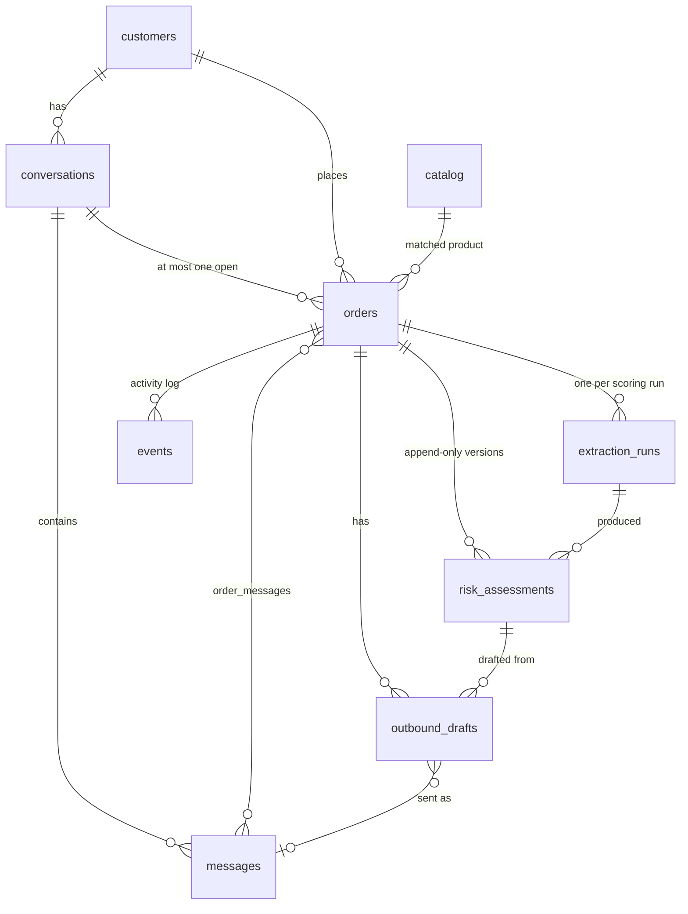

# Data model

The concepts Wasel stores and passes around, what they mean, and the rules the database enforces. The executable definitions are `src/wasel/db/schema.sql` (tables), `src/wasel/contracts.py` (the dataclasses exchanged between the persistence layer and the scoring core) and `src/wasel/api/models.py` (what the API returns). This page explains their semantics; it does not repeat every column.

## Overview

Three tables deliberately have no foreign keys into the order graph: `extraction_cache` (reusable LLM results), `llm_usage` (provider calls, which drive the caps) and `events` (the activity feed, cursor `seq`). The usage rows and the cache rows loaded from the seed file or made from event data therefore outlive purged orders; cache rows made from a visitor's text carry that visitor's `sandbox_id` and are deleted with the sandbox; events are deleted explicitly by the purge. [Persistence lifecycle](#persistence-lifecycle) lists what each operation removes.

## Conventions

| Topic | Rule |
|---|---|
| Identifiers | Text ids made of a prefix and a ULID: `cus_`, `cnv_`, `msg_`, `ord_`, `ext_`, `asm_`, `drf_` (`wasel/ids.py`). Tests use sequential ids (`ord_0001`). The human-facing order reference is `#<order_no>`. |
| Order numbers | Unique integers. The nine sample orders are 2601 to 2609; a new order takes `MAX(order_no) + 1` (2601 when the table is empty), computed inside the write transaction. |
| Timestamps | UTC text `YYYY-MM-DDTHH:MM:SS.ffffffZ`, produced only by `wasel.clock.utc_iso()`. The fixed width makes them sort lexicographically. `hygiene` forbids reading the clock anywhere else. |
| Sandbox scoping | `sandbox_id` is `NULL` for seeded and real (`event`/`dev`) rows, and the visitor's `X-Visitor-Id` UUID for rows created in `public` mode. The header is not authentication: it scopes visibility, nothing more. |
| Personal data | `customers.phone_e164` never leaves the database unmasked (`+216 •• ••• 001`), and is never sent to an LLM. API response models contain neither `phone_e164` nor `raw_payload`; a test checks this. |
| JSON columns | Text columns ending in `_json` hold JSON written by the repository (`repo._j`). They are documented below where they matter. |
| Schema changes | There are no migrations. `schema.sql` is the schema; changing it means rebuilding the database (`make seed`, or any start with `SEED_ON_BOOT=always`). |

## Entities

### Customer

A person the shop talks to. Real customers (WhatsApp) are identified by `phone_e164`, which is unique across the whole database; sample and pasted customers have no phone. `external_ref` is a slot for a seller-supplied customer id, unique within a sandbox; the current paste and CSV ingestion do not set it.

- `completed_orders` counts orders that ended `delivered` or `refused`; `refusals_total` counts the refused ones. A check enforces `0 ≤ refusals_total ≤ completed_orders`.
- Both counters change only when a seller applies `mark_delivered` or `mark_refused`. They feed the `customer_refusal_rate` feature as `(refusals + 0.6) / (completed + 2)`, so a new customer is 0.30.
- Lifecycle: created at first contact, refreshed on later contact (`last_seen_at`), deleted by a sandbox purge once none of their conversations remain.

### Conversation

A thread with one customer on one channel (`whatsapp`, `csv`, `paste` or `simulated`). It records `last_inbound_at` and `last_outbound_at`; the first is what the 24-hour WhatsApp window is measured from. Sample conversations carry a `seed_key` (`hero`, `fr_exact`, ...), which is what makes "Try this order" possible.

A WhatsApp customer keeps one long-lived conversation; each pasted or CSV order creates a new one.

### Message

One inbound or outbound message.

| Field | Semantics |
|---|---|
| `direction`, `author` | `inbound` is always `customer`. `outbound` is `seller` or `ai`. A check enforces this pairing. |
| `origin` | `whatsapp`, `csv`, `paste`, `simulated`, `seed`, `dashboard` |
| `kind` | `text`, `audio`, `location`, `image`, `interactive`, `unsupported`. Only text, transcribed audio and location pins reach the model. |
| `text` | The original stored text. For `author='ai'` it is the text that was actually sent, which may be an LLM rewrite. |
| `canonical_text`, `template_id` | For `author='ai'` (required by a check): the static template rendered with slots. **This** is what appears as the `[SELLER]` line in later extractions. |
| `channel_message_id` | The WhatsApp `wamid`; `UNIQUE`, so a duplicate insert is ignored. |
| `provider_ts`, `received_at` | When the provider says it happened, and when Wasel stored it. Ordering uses `provider_ts`. |
| `delivery_status` | `queued`, `sent`, `delivered`, `read`, `failed`. Only moves forward (`sent < delivered < read < failed`) and only on outbound rows. |
| `raw_payload` | Reserved for debugging. Current code does not write it. |

### Order

The unit of scoring and of seller action. An order is created by the first message of a conversation that has no open order and covers all messages linked to it through `order_messages`.

| Field | Semantics |
|---|---|
| `status` | `collecting`, `awaiting_reply`, `needs_review`, `ready_to_ship`, then `shipped`, `delivered`, `refused` or `cancelled`. See [order states](order-pipeline.md#order-states). |
| `product_id`, `product_name`, `quantity`, `price_tnd`, `zone`, `zone_source`, `address_text`, `language` | Resolved by the scorer after every scoring (`OrderPatch`). `price_tnd` comes from the seller-entered value or the catalog, never from the LLM. `zone_source` is `csv` (seller-entered), `gazetteer` or `default`. `address_text` is the verified address quotes joined with ` · `. |
| `structured_json` | The seller-entered fields (`product_name`, `price_tnd`, `zone`, `quantity`) exactly as given at ingestion. They win over catalog and gazetteer values. |
| `current_assessment_id` | Pointer to the latest `risk_assessments` row. The foreign key is deferred so an order can point at an assessment inserted in the same transaction. |
| `pending_rescore_at`, `pending_trigger`, `rescore_state` | Scheduling. See [debounce](order-pipeline.md#debounce-and-claiming). |
| `awaiting_reply_since` | Set when a draft is sent; drives the no-reply timeout. |
| `seller_approved_at` | Set by the `approve` action. |
| `auto_messages_sent` | Messages sent without a click for this order (0 to 2, enforced by a check). |

Invariants enforced by constraints: a partial unique index allows at most one open order per conversation; `pending_rescore_at` and `pending_trigger` are both null or both set; `quantity` is 1 to 50.

### Extraction run

A record of one attempt to extract facts from the conversation, kept for audit. Append-only. It stores the ordered ids of the messages used (`input_message_ids`: the `msg_idx` in every stored quote refers to this list), the `input_hash` (the cache key), the provider and model (`rules` and `rules_v1` for the rules extractor), the prompt version, `cache_hit`, the per-attempt outcomes, the raw provider text (null on cache hits and rules), the final validated extraction (`validated_json`), the evidence spans (`spans_json`, code-point offsets into the **original** message text) and counters (`dropped_flags`, `dropped_quotes`, `injection_suspected`, token counts, latency, error). `valid` is 0 when the result came from the rules extractor. A no-reply rescore creates no run; its assessment points at the previous one.

### Assessment

The scoring result for one order at one moment. **Append-only**: a rescore inserts version *n+1* and never edits earlier versions; `(order_id, version)` is unique.

| Field | Semantics |
|---|---|
| `trigger` | `initial`, `customer_reply`, `no_reply_timeout`, `manual` |
| `path` | Where the extraction came from: `llm` (primary model), `fallback_model`, `fallback_provider`, `cascade_cache` (served from the extraction cache), `rules`. `cascade_ack` is allowed by the schema but no code produces it. |
| `features_json` | Exactly the six model inputs: `address_specificity`, `red_flag_count`, `tone_score`, `price_tnd`, `zone_encoded`, `customer_refusal_rate` |
| `context_json` | Provenance and display data: `has_geo_pin`, `product_id`, `product_category`, `quantity`, customer history counts, `zone_source`, `imputed` (features filled from defaults), `resolved_flags`, `tone_reset`, `address_level_raw` and `address_level_final`, `clarity`, `language`, `tone`, `path_origin`, plus `points` (per-feature score points, used by the next reason diff) and `injection_suspected`. |
| `model_score` | 0 to 100, one decimal: 100 × model probability |
| `confirmation` | The customer's effective answer after cross-field rules: `none`, `confirmed`, `declined`, `reschedule`, `ambiguous` |
| `adjustments_json` | Post-model rules that changed the score, each with `rule`, `label`, `effect`, `before`, `after` |
| `flags_json`, `resolved_flags_json` | Surviving evidence-checked red flags (`code`, `quote`, `message_id`) and the codes that code dropped as resolved |
| `final_score`, `tier`, `action` | Integer 0 to 100; `low` / `medium` / `high`; `ship` / `confirm` / `prepay` / `review` / `cancelled` |
| `confidence`, `confidence_reasons_json` | `high` or `low`, with the reasons. See [scoring](../subsystems/scoring.md#confidence). |
| `reason`, `reason_short`, `reason_diff` | Deterministic text built from the points. `reason_short` is at most 90 characters; `reason_diff` is null on version 1. |
| `top_factors_json` | The three largest per-feature contributions |
| `classifier_version`, `config_hash`, `prompt_version` | The exact model file (`xgb_v1-<sha8>`), configuration digest and prompt version that produced it |
| `template_id` | The template chosen for a follow-up question, if any |

A check ties two fields together: `action = 'cancelled'` exactly when `confirmation = 'declined'`. `final_score` is never null, even for a declined order.

### Outbound draft

A drafted message for an order, tied to the assessment it was made from. `canonical_text` is the rendered static template; `rendered_text` is what would be sent (the approved rewrite, or the canonical text); `source` is `llm_rewrite` or `static_template`. `prefilter_json` holds the deterministic check result. `judge_json` holds the judge and guard-classifier result, is null for static templates, and is required (a check) for rewrites; `{"unavailable": true, ...}` means the judge could not answer. `route` is `auto_send`, `needs_review` or `blocked`.

An order can have any number of sent drafts but at most one unsent draft (partial unique index). A send first sets `sending_at` (a claim, cleared on failure), then sets `sent_message_id`, `sent_at`, `delivery` (`whatsapp_sent` or `recorded_only`) and `decided_by` (`human` or `system`), and creates the outbound message. See [outbound](../subsystems/outbound.md).

### Event

The activity log: `message.received`, `order.rescored`, `draft.created`, `draft.judged`, `draft.sent`, `llm.fallback`, `llm.cap_reached`, `cache.hit`, `evidence.dropped`, `flags.resolved`, `injection.suspected`, `extraction.not_order`, `webhook.rejected`, `webhook.malformed`, `webhook.process_error`, `draft.send_failed`, `error`, `order.<seller action>` and others. `seq` is a monotonic cursor for `GET /api/events?after=`. Events have no foreign key to orders; the purge deletes them explicitly.

### LLM usage and extraction cache

`llm_usage` has one row per provider attempt (successful or not) with role, provider, model, outcome, tokens and latency. It counts against the daily and per-visitor caps and outlives orders; purges delete rows older than two days. `extraction_cache` maps `input_hash` to a validated extraction and a prompt version; `sandbox_id` names the visitor whose text produced the row (NULL for seed and event data), and an upsert never turns a NULL row into a visitor's. An upsert replaces an entry only if the new one is at least as primary (`is_primary`), so a fallback result can never overwrite a primary one.

### Catalog

`catalog` mirrors [`data/catalog.yaml`](../data.md#top-level-files) and is refreshed from it on every boot. It exists in the database so `orders.product_id` can be a foreign key.

## The 12-field extraction

`OrderExtraction` (`src/wasel/extraction/repair.py`, schema in `config/schemas/order_extraction_v1.json`) is what an LLM or the rules extractor produces before any verification:

| Field | Type and values | Meaning |
|---|---|---|
| `is_order` | bool | The customer wants to buy or continues an order |
| `is_order_change` | bool | Changes product, quantity or recipient, or adds a second order |
| `product_quote` | string or null | The customer's words naming the product |
| `quantity` | int 1 to 50 or null | An explicit count only; out-of-range values become null |
| `address_quotes` | up to 4 strings | Location phrases, copied verbatim |
| `address_level` | `none`, `city_only`, `area_or_landmark`, `street_and_landmark`, `exact` | Most specific location given so far |
| `red_flags` | up to 6 of `{evidence, code}` | `availability_uncertain`, `vague_location`, `price_hesitation`, `third_party_recipient`, `prior_refusal_mention`, `pressure_or_inconsistency`; one per code |
| `tone_evidence`, `tone` | string or null; `positive`, `neutral`, `uncertain`, `negative` | Attitude, with a supporting quote when not neutral |
| `confirmation` | `none`, `confirmed`, `declined`, `reschedule`, `ambiguous` | Answer to the latest seller line |
| `language` | `fr`, `ar`, `darija_arabic_script`, `arabizi`, `mixed` | Language of the customer lines |
| `clarity` | `clear`, `partial`, `unclear` | How understandable the order is |

Invariants after `postprocess`: every surviving quote is a verbatim (normalized) substring of one customer line; `address_level` is `none` if no address quote survived; `exact` requires a standalone number or a building word; a location pin forces `exact`; `confirmation` is `none` unless a customer line follows a seller line.

## Other structured artifacts

| Artifact | Where | Shape |
|---|---|---|
| Score input and result | `contracts.py` | `ScoreInput` (messages, structured fields, customer history, prior assessment, time) → `ScoreResult` (extraction record, cache entry, assessment, order patch, template id, usage records, events). Frozen dataclasses. |
| Golden evaluation cases | `data/eval/golden/*.jsonl`, `data/eval/sets/*.jsonl` | One JSON object per line with an `id`, an `input` and an `expected` (or `labels`) block. See [evaluation](../evaluation.md#golden-sets). |
| Model card | `models/risk_xgb_v1.card.json` | Hyperparameters, feature order, monotone constraints, SHA-256 of the model and dataset, generator metadata, library versions, reliability table. See [machine learning](../machine-learning.md#model-artifact-and-card). |
| Reports | `data/reports/*.json` | Evaluation, training metrics, simulated impact, failure analysis. Some are read by the API at runtime. See [data](../data.md#datareports). |
| Analyzer sessions | `data/agent_sessions*.jsonl` | Ordered `events` (`agent`, `user`, `tool_call`, `tool_result`), a `context`, a `final` status and a `label`. See [failure analysis](../subsystems/failure-analysis.md). |
| Monitor reference | `data/monitor_reference.json` | Category distributions (language, address level, tier) that drift is measured against. |

## Persistence lifecycle

| Event | Effect on stored data |
|---|---|
| Start with `SEED_ON_BOOT=always` (default in `public` mode, and `make up`) | The database file and its WAL files are deleted, the schema is recreated, and the catalog, the committed extraction cache and the nine sample orders are loaded. |
| Start with `if_empty` (default in `dev` and `event`) | The schema is created if missing; samples are seeded only if there are no orders. Existing data is kept. |
| Start with `never` | Only the schema is created if missing. |
| Sandbox purge (public mode, every `PURGE_INTERVAL_S`) | Deletes sandbox conversations opened more than `SANDBOX_TTL_S` (2 h) ago, with their orders, messages, assessments, extraction runs, drafts and events; sandbox customers left without conversations; `extraction_cache` rows made from sandbox text; and `llm_usage` rows older than two days. The TTL runs from when the conversation was opened, not from the last activity. |
| `POST /api/admin/reset` | Deletes every order-side row (events, drafts, assessments, extraction runs, order messages, orders, messages, conversations, customers) and reseeds. Deletes the cache rows made from visitor text; keeps `catalog`, the other `extraction_cache` rows and `llm_usage`. |
| `make clean` | Deletes `var/*.db` and the WAL and SHM files. |
