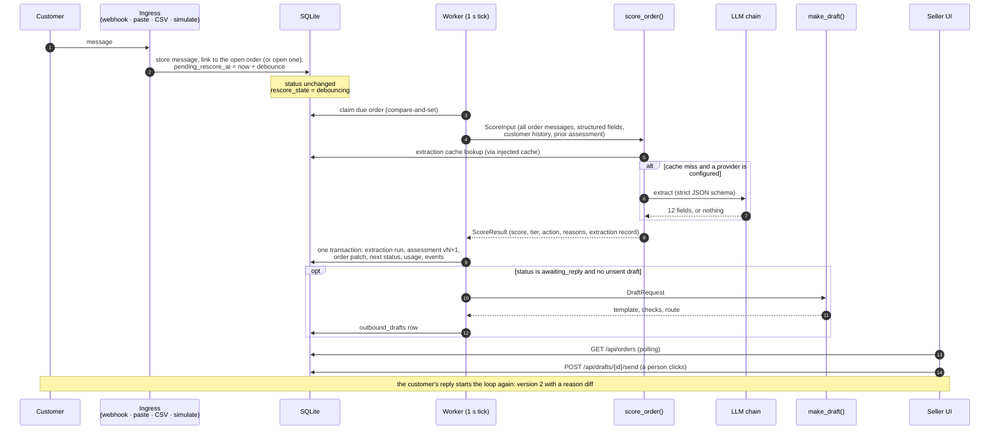
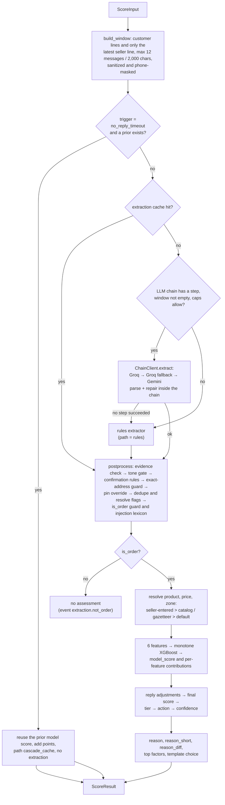
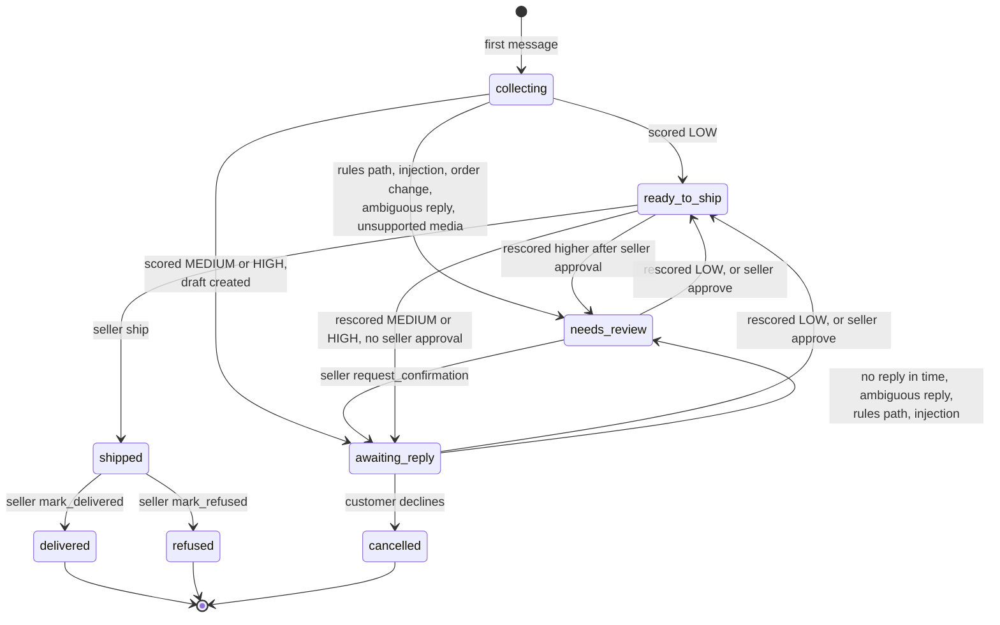

# Order pipeline

What happens to a customer message from the moment it arrives until a seller sees a scored order and a drafted question, and what happens again when the customer replies. The stored entities are described in the [data model](data-model.md); each scoring step has its own reference in the [subsystems](../subsystems/).

## One message, end to end



## Entry points

Every way of adding customer text calls `store_inbound()` (`src/wasel/ingress/ingest.py`). That is why each fallback and each demo path exercises the same code as production.

| Entry | Code | Notes |
|---|---|---|
| WhatsApp webhook | `api/routes_webhook.py` → `store_message` | Signed, size-capped, deduplicated by message id. Customer is looked up by phone number; the conversation is the customer's latest WhatsApp conversation. |
| Paste | `POST /api/orders/ingest` (`kind: "paste"`) → `commands.ingest_paste` | Creates a customer, a conversation on channel `paste` and an order. 1 to 2,000 characters. |
| CSV | `POST /api/orders/ingest` (`kind: "csv"`) → `commands.ingest_csv` | Up to 10 rows in public mode, 200 otherwise. Each row goes through `ingest_paste`; row text is `address` plus `note`. `product`, `price_tnd` and `zone` become seller-entered structured fields. |
| Simulated reply | `POST /api/conversations/{id}/simulate-reply` | Text (up to 600 characters) or a location pin. If the order has an unsent draft, it is first recorded as sent, since the reply implies it went out. |
| Sample seeding | `db/seed.py` → `seed_conversation` | Runs at boot, with `no_debounce=True`. |
| Try this order | `POST /api/orders/{id}/try` | Copies a sample conversation into the caller's sandbox and scores it immediately. |

`store_inbound()` does the following inside the caller's transaction:

1. Inserts the message. A duplicate `channel_message_id` (WhatsApp `wamid`) is ignored and returns without arming a rescore.
2. Finds the conversation's open order (`collecting`, `awaiting_reply`, `needs_review` or `ready_to_ship`), or creates one in `collecting`. A conversation has at most one open order, enforced by a partial unique index. A message on a conversation whose order is `shipped`, `delivered`, `refused` or `cancelled` therefore opens a new order.
3. Links the message to the order (`order_messages`) and updates `conversations.last_inbound_at`.
4. Arms a rescore (see below) with trigger `initial` for a new order or `customer_reply` for an existing one.
5. Writes a `message.received` event.

Inbound audio, images, stickers and other unsupported WhatsApp types are stored as `kind='unsupported'` with no text. They still arm a rescore. In the scoring window they set `has_unsupported_media`, which sends an order that has other text to `needs_review`. A conversation whose only content is unsupported media yields no order text, the extraction is "not an order", and the order stays in `collecting`, which the default queue hides.

## Debounce and claiming

Scoring is never done in the request that stored the message. The order row carries the scheduling state:

| Column | Meaning |
|---|---|
| `pending_rescore_at`, `pending_trigger` | When the order is due for scoring and why (`initial`, `customer_reply`, `no_reply_timeout`, `manual`). Both are null or both set. |
| `rescore_state` | `idle`, `debouncing` (pending), `scoring`, or `drafting` |

`arm_rescore` sets `pending_rescore_at = now + debounce` and keeps the first pending trigger, so a burst of messages produces one rescore that still counts as the first cause. The debounce is 4 seconds when `DEMO_MODE=true` (the default) and 15 seconds otherwise (`timeouts.debounce_s` in [`config/scoring.yaml`](../configuration/scoring.md)). The ingest endpoint returns `rescore_eta_s`, the debounce plus one second.

Every second the worker (`AppState.tick` → `worker.process_due`) does this:

1. In non-public modes, queue a `no_reply_timeout` rescore for orders that have been `awaiting_reply` for longer than `timeouts.no_reply_s` (60 s in demo mode, 6 hours otherwise) and have not already been timed out since the last draft was sent.
2. Take up to 10 due orders, oldest first. For each, claim it with `UPDATE ... WHERE pending_rescore_at = <the value it read>`. A lost race (`rowcount == 0`) skips the order.
3. Build the `ScoreInput` from the database, call the scorer **outside** any transaction (it may make network calls), then write the result in one transaction.
4. If the new status is `awaiting_reply` and no unsent draft exists, create the draft in a second transaction.
5. If `WA_AUTO_SEND` is on and the mode is not public, send every unsent draft whose route is `auto_send` (see [outbound](../subsystems/outbound.md)).

If scoring raises, the order moves to `needs_review` (unless already terminal), an `error` event is written and the order is **not** re-armed. It stays there until a person acts, a new message arrives, or someone calls `POST /api/orders/{id}/rescore`. Provider failures are not exceptions: they produce an ordinary result on the rules path.

## Scoring one order

`score_order()` (`src/wasel/scoring/score_order.py`) is a pure function: it receives its dependencies as arguments and returns a `ScoreResult` without touching a database or the clock. The flow, as implemented:



A few points that the diagram compresses:

- **Window.** Only customer text, voice transcripts and location pins go to the model. The seller line is always the *canonical* template text, never a rewritten draft, so the model input cannot be influenced by an LLM rewrite. Over the cap, the oldest customer messages before the seller line are dropped first.
- **Cache.** A hit yields path `cascade_cache` (a historical name that now simply means "extraction served from the cache") and the entry's original path is kept in the assessment context as `path_origin`. Only results that came from the primary model are written to the cache, and fallbacks never are. Cross-field rules, the pin override and flag resolution are re-run on every hit, so they always reflect current code.
- **Caps.** Before each provider call the chain asks the usage meter. A cap ends the chain with no result and the order is scored on the rules path. See [LLM layer](../subsystems/llm.md#caps-and-the-usage-meter).
- **Rules path.** The rules extractor produces an `OrderExtraction` that goes through the same `postprocess`. The result has path `rules`, action `review`, `confidence=low` and status `needs_review`. The score is still computed from whatever the rules found.
- **No LLM after a timeout.** A no-reply rescore never extracts: it reuses the prior extraction and features, adds the configured points, and records `confidence=low` with reason `no_reply_timeout`.
- **Unavailable model file.** If `models/risk_xgb_v1.json` is missing, the scorer uses the documented prior (`ml/features.py: score_prior`), sets classifier version `prior_v1` and writes a reason saying the model is unavailable.

The detailed rules for each stage are in [extraction](../subsystems/extraction.md) and [scoring](../subsystems/scoring.md).

## What gets written

`repo.persist_result` writes one rescore in a single transaction, together with the status change from `next_status()`:

| Written | Content |
|---|---|
| `extraction_runs` | The extraction attempt: provider, model, prompt version, attempts, raw output, validated output, evidence spans, dropped counts, injection flag, error. Skipped for a no-reply rescore. |
| `extraction_cache` | The validated extraction, only for a fresh primary-model result. |
| `risk_assessments` | Version *n+1*: path, features, context, model score, confirmation, adjustments, flags, final score, tier, action, confidence and reasons, reason text and diff, top factors, versions and config hash. Never updated afterwards. |
| `orders` | `current_assessment_id`, `rescore_state`, `status`, and the resolved product, price, quantity, zone, address text and language. |
| `llm_usage` | One row per provider attempt, including failed ones. These rows drive the caps. |
| `events` | The scorer's events (`cache.hit`, `llm.fallback`, `llm.cap_reached`, `evidence.dropped`, `flags.resolved`, `injection.suspected`, `extraction.not_order`) and `order.rescored`. |

The draft is written afterwards in its own transaction, tied to the assessment it was made from.

## Reply and rescore

A customer reply is just another message on the same open order. The next rescore sees all messages linked to the order, the latest seller line (the canonical text of the question that was sent) and the prior assessment. Three things follow from that:

1. The extraction can now read a `confirmation` (`confirmed`, `declined`, `reschedule`, `ambiguous`), because there is a seller line with a customer line after it.
2. Code can resolve flags: a `vague_location` flag is dropped once the address level becomes `exact`; an `availability_uncertain` flag is dropped once the customer confirms or reschedules after the seller line; `price_hesitation` is dropped on a confirmation.
3. The reason diff compares per-feature points of the two versions.

For the sample order #2601 (from the frozen fixtures in `tests/fixtures/hero/`, pinned in `tests/golden/hero.json`):

```
v1  HIGH 87  base 30 · 3 warning signs "9rib el jemaa" +17 · rural delivery zone +13 · vague address ("Douar Ouled Ali") +12
v2  LOW  16  full address given −19 · no warning signs −3 · rural delivery zone +11 · customer confirmed ×0.6 −11
diff v1 87 → v2 16 · full address given −32 · warning signs resolved (availability_uncertain, price_hesitation, vague_location) −20 · tone uncertain → neutral −8 · customer confirmed ×0.6 −11
```

The model alone gives v2 a score of 26.8 (still LOW); the confirmation multiplier of 0.6 brings it to 16.

## Order states

Statuses are stored in `orders.status`. They change in two ways: automatically after each scoring (`state.next_status`) and by seller actions (`state.ACTIONS`). An action that is not allowed from the current status returns `409 INVALID_TRANSITION` with the allowed actions in `details.allowed`.



A seller `cancel` works from `collecting`, `awaiting_reply`, `needs_review` and `ready_to_ship`. A customer decline moves any scored order to `cancelled`.

### Automatic transitions

`next_status()` evaluates these rules in order and the first match wins:

| # | Condition | Result |
|---|---|---|
| 0 | injection suspected | `needs_review` |
| 1 | the text is not an order (no assessment) | status unchanged |
| 2 | customer declined | `cancelled` |
| 3 | customer changed product, quantity or recipient | `needs_review` |
| 4 | rules path, invalid extraction, or unsupported media | `needs_review` |
| 5 | trigger is `no_reply_timeout` | `needs_review` |
| 6 | reply is ambiguous | `needs_review` |
| 7 | already `ready_to_ship`, the seller approved, tier did not rise | `ready_to_ship` |
| 8 | already `ready_to_ship`, the seller approved, tier rose | `needs_review` |
| 9 | tier is `low` | `ready_to_ship` |
| 10 | currently `needs_review` | stays `needs_review` |
| 11 | anything else (medium or high) | `awaiting_reply` |

### Seller actions

| Action | Allowed from | Result | Side effects |
|---|---|---|---|
| `approve` | `needs_review`, `awaiting_reply` | `ready_to_ship` | sets `seller_approved_at`, which makes rule 7 keep the status through later soft rescores |
| `request_confirmation` | `needs_review` | `awaiting_reply` | creates a draft if none is unsent |
| `cancel` | `collecting`, `awaiting_reply`, `needs_review`, `ready_to_ship` | `cancelled` | |
| `ship` | `ready_to_ship` | `shipped` | |
| `mark_delivered` | `shipped` | `delivered` | increments the customer's `completed_orders` |
| `mark_refused` | `shipped` | `refused` | increments `completed_orders` and `refusals_total`, which feed `customer_refusal_rate` on that customer's next order |

Each action writes an `order.<action>` event. In public mode actions on sample rows return `409 SEEDED_READ_ONLY`.

## Failure behaviour along the pipeline

| Situation | Behaviour |
|---|---|
| No API key, unknown model, provider down, timeout, 429, schema rejection, truncated or unparsable answer | Next chain step, then the rules extractor. Recorded in `extraction_runs.attempts_json` and `llm_usage`, with an `llm.fallback` event. Order goes to `needs_review`. |
| Daily or per-visitor LLM cap reached | Rules extractor, `llm.cap_reached` event, `confidence=low` with reason `llm_cap_reached`. Never an HTTP error. |
| Model quotes text the customer did not write | The quote is dropped and counted (`dropped_quotes`, `dropped_flags`); if every address quote drops, the address level becomes `none`. |
| Injection phrase in customer text | Order is scored normally but flagged: `injection_suspected`, `confidence=low`, `needs_review`, confirmation ignored. |
| Duplicate webhook delivery | Ignored; no second message, no rescore. |
| Exception while scoring | Order to `needs_review`, `error` event, not re-armed. |
| WhatsApp send refused (draft) | `502 WHATSAPP_SEND_FAILED`, a `draft.send_failed` event, and the draft stays unsent. |
| Process restart | On boot every order's `rescore_state` is reset to `debouncing` if a rescore is pending, else `idle`. Pending rescores survive because they are stored in the database. |
