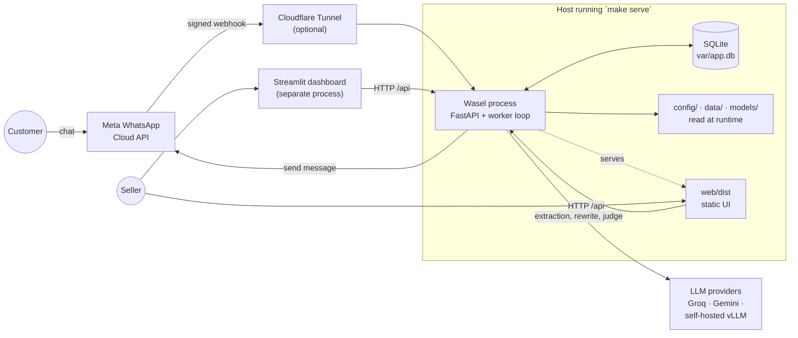
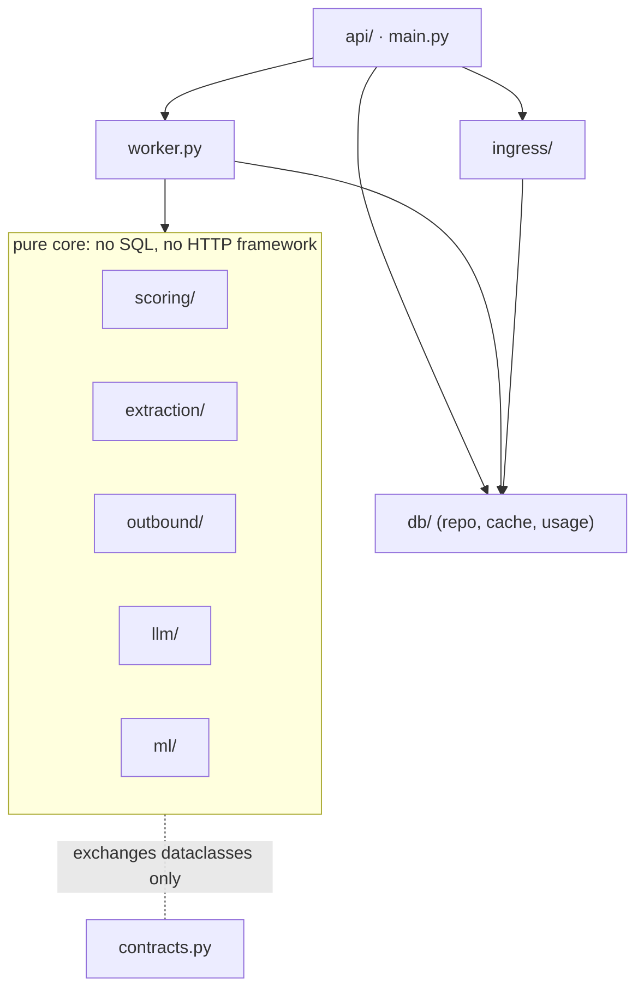

# Architecture overview

Wasel is one Python process that stores conversations in SQLite, scores orders in a background loop and exposes everything through an HTTP API. This page describes the parts, what crosses each boundary, and the modes the process can run in. The next pages go deeper: [order pipeline](order-pipeline.md) for the flow of one message, [data model](data-model.md) for the stored entities, and the [subsystem references](../subsystems/) for each component.

## System context

| Actor or system | Interaction |
|---|---|
| Customer | Writes to the shop's WhatsApp number. Never touches Wasel directly. |
| Seller | Uses the web UI or the dashboard to read the queue, send drafted questions and move orders through their lifecycle. |
| Meta WhatsApp Cloud API | Delivers inbound messages and delivery statuses to `POST /webhook/whatsapp` (HMAC-signed) and accepts outbound text messages from `WhatsAppSender`. Only used in `dev` or `event` mode with WhatsApp secrets configured. |
| LLM providers | Receive the rendered conversation window for extraction, and template text for rewrite and judge. Called over HTTPS with `httpx`. All are optional. |
| Cloudflare Tunnel | Optional publisher for a host without open ports. Wasel does not know about it. |
| Filesystem | `config/`, `data/` and `models/` are read from the repository checkout; `data/reports/` files are read at runtime by the API. |

## Components

| Component | Package | Why it exists | In → out |
|---|---|---|---|
| HTTP API | `src/wasel/api/` | The only interface to the system; keeps mutation logic out of route handlers. | HTTP requests → JSON. `commands.py` holds mutations, `projections.py` builds read models, `models.py` defines the response contract. |
| App factory and state | `main.py`, `settings.py`, `mode.py` | Builds the FastAPI app, wires settings, clock, id generator, LLM client and scoring config, runs boot seeding and the worker. | environment → configured app |
| Ingress | `ingress/` | One ingestion function for every channel, plus the pure half of the WhatsApp webhook (signature check, payload parsing). | message → stored message, order, armed rescore |
| Database layer | `db/` | SQLite connections, the schema, the repository (all SQL), the extraction cache, the LLM usage meter, seeding and purging. | dataclasses ↔ rows |
| Worker | `worker.py` | Debounced rescoring, no-reply timeouts, draft creation. Runs once per second inside the API process. | due orders → assessments, statuses, drafts, events |
| Extraction | `extraction/` | Turns a conversation into a verified 12-field record: builds the LLM window, repairs and verifies the model's answer, applies cross-field and injection rules, provides the rules extractor. | messages → `Processed` extraction |
| LLM layer | `llm/` | One governed entry point for every model call: provider chain, timeouts, circuit breaker, caps, prompts, traces, test doubles. | task + text → parsed result or "no result" |
| Scoring | `scoring/` | Resolves product, price and zone, runs the risk model, applies reply adjustments, decides tier, action and confidence, builds reasons. | `ScoreInput` → `ScoreResult` (pure function) |
| ML | `ml/` | The feature contract shared by training and serving, the synthetic data generator, the trainer. Nothing here runs per request except `features.py`. | synthetic CSV → `models/risk_xgb_v1.json` |
| Outbound | `outbound/` | Chooses a template, optionally has an LLM reword it, checks every draft, routes it, sends through WhatsApp. | `DraftRequest` → `DraftRecord` |
| Monitor | `monitor.py` | Drift and safety rates from stored assessments, drafts and LLM usage, for `GET /api/monitor`. | tables → rates and alerts |
| Failure analyzer | `failures/` | Finds silent failures in agent conversations (claimed success without a successful tool call, and similar) in synthetic sessions or in this app's own orders. | sessions → ranked issues |
| Evaluation | `evaluation/` | Golden-set builder and gate runner used by `make eval`. | golden files + thresholds → `data/reports/eval.json` |
| Web UI | `web/` | The seller-facing Next.js app, built to static files that the API serves at `/`. | `/api` JSON → screens |
| Dashboard | `dashboard/` | A Streamlit UI with the same functions, run as its own process. | `/api` JSON → screens |

### Dependency rule

The scoring core is kept free of infrastructure. A test (`test_layering` in `tests/unit/test_ml.py`) fails if anything under `llm/`, `extraction/`, `scoring/`, `outbound/` or `ml/` imports `sqlite3`, `fastapi`, `wasel.db`, `wasel.api`, `wasel.ingress` or `wasel.worker`. Another test keeps `ml/generate.py`, `train.py`, `features.py` and `textnorm.py` free of any LLM or HTTP import. As a result the core communicates only through the dataclasses in `src/wasel/contracts.py`:

Inside the core the packages call each other freely (for example `scoring` uses `extraction`, `llm` and `ml.features`; `outbound` uses `llm` and reads the same scoring config). The rule is only about what the core may not import.

The scorer receives its cache, LLM client, usage meter and configuration as arguments (`score_order(inp, cache=, llm=, meter=, config=)`), which is why tests can run it with fake dependencies and no network. The database layer implements the `ExtractionCache` and `UsageMeter` protocols from `contracts.py`.

## Runtime boundaries

**Process.** One Uvicorn process with one worker (`make serve` passes `--workers 1`). Everything below happens inside it. The dashboard is a second, separate Streamlit process that only speaks HTTP. `cloudflared` and, for the self-hosted LLM, vLLM are further separate processes or hosts.

**Threads and asynchronous boundaries.**

- Route handlers are synchronous functions, so FastAPI runs them in its thread pool. Each thread opens its own SQLite connection on first use (`AppState.conn`, thread-local).
- The worker is an asyncio task started in the app lifespan. Every second it calls `state.tick` through `asyncio.to_thread`, and in public mode it also purges expired sandboxes every `PURGE_INTERVAL_S`.
- Rescoring is deferred by design: a message only writes `pending_rescore_at`, and the worker later picks the order up. Message bursts therefore collapse into one rescore (see [debounce](order-pipeline.md#debounce-and-claiming)).
- The WhatsApp webhook answers `200` only after the signature check and the commit of the message, and `503` if it could not be stored so Meta retries. Scoring stays with the worker, so Meta never waits for it.
- LLM calls and WhatsApp sends are blocking `httpx` calls made from whichever thread needs them, normally the worker thread. A slow provider therefore delays the tick; per-step timeouts (6 s, 5 s and 8 s) and a 20 s chain deadline bound it, and `/api/health` reports `degraded` if the worker has not ticked for 10 seconds.

**External services.** Providers are called only through `ChainClient` (`src/wasel/llm/client.py`), with no retries. The WhatsApp sender is the one component that retries (two extra attempts with exponential backoff, transient errors only). Every external call has a timeout, and none is required for the process to run.

**Database.** A single SQLite file in WAL mode with `foreign_keys=ON`, `busy_timeout=5000` and `synchronous=NORMAL`. Writes use explicit `BEGIN IMMEDIATE` transactions (`db.conn.tx`). The design assumes one API process: the worker claims work with a compare-and-set update, which is safe across threads but the deployment is not meant to scale horizontally. There are no migrations. The schema is rebuilt from `schema.sql` whenever the database is reseeded, and an existing database is not upgraded when the schema changes.

**Model boundaries.** The risk model is an in-process XGBoost booster loaded once per file path (`scoring/model.py`, `lru_cache`). The outbound guard classifier is trained in process on first use from `data/draft_guard.yaml` and the templates, which takes a moment and produces no artifact. The only remote model is the LLM, and it never produces a score, tier, status or price.

**Caches.**

| Cache | Where | Lifetime | Purpose |
|---|---|---|---|
| Extraction cache | SQLite `extraction_cache` | Persistent; survives admin reset and sandbox purge | Skip the LLM for a conversation window already extracted. Keyed by a hash of prompt version and rendered window. Preloaded from `data/seed/extraction_cache.jsonl`. |
| Rewrite and judge response cache | `ChainClient` LRU (512 entries) | Process | Identical draft requests reuse the model's answer. |
| Config, registry, model | `lru_cache` in `scoring/config.py`, `llm/prompts.py`, `scoring/model.py` | Process | Files are read once. Changing `config/*.yaml`, prompts or the model file needs a restart. |
| Trace ring buffer | `llm/trace.py` (5,000 records) | Process | Backs `GET /api/traces` and part of `GET /api/monitor`. Lost on restart unless `TRACE_FILE` is set. |
| HTTP | `Cache-Control: no-store` on API JSON | n/a | The UIs poll; nothing is cached by browsers. |

## Modes

`APP_MODE` is the single switch that decides what the process may expose. A missing or unrecognized value resolves to `public`, with a warning in the log.

| | `dev` | `event` | `public` (default) |
|---|---|---|---|
| Intended use | local development | a live deployment connected to a real WhatsApp number | anonymous visitors, demos |
| WhatsApp webhook | mounted when `WEBHOOK_ENABLED`, `WA_APP_SECRET` (≥16 chars) and `WA_VERIFY_TOKEN` (≥24 chars) are set | same | never mounted |
| Sending through WhatsApp | when `WA_SEND_ENABLED`, `WA_TOKEN` and `WA_PHONE_NUMBER_ID` are set | same | forced off |
| Automatic sending (`WA_AUTO_SEND`) | allowed | allowed | forced off |
| Who sees which rows | everything | everything | seeded rows plus the caller's own sandbox (`X-Visitor-Id`) |
| Sample (seeded) rows | writable | writable | read-only; `POST /api/orders/{id}/try` copies one into a sandbox |
| `X-Visitor-Id` header | ignored | ignored | required on every mutation |
| Sandbox limits and purge | none | none | 15 orders per visitor, 500 in total; expired after 2 h, purged every 10 min |
| No-reply timeout | on | on | off |
| Default daily live-LLM call cap | none | 300 | 80 |
| Default `SEED_ON_BOOT` (`auto`) | `if_empty` | `if_empty` | `always`: the database is deleted and rebuilt at every start |
| Interactive `/docs` page | on | on | off (`/openapi.json` is still served) |
| CORS for `FRONTEND_ORIGIN` | on | off | off |

The `admin` router (`POST /api/admin/reset`) is mounted in any mode when `ADMIN_TOKEN` is at least 24 characters. The values in `dev` and `event` differ only in the default LLM cap and CORS. The [API page](../api.md) lists what each mode changes at the endpoint level, and [SECURITY.md](../../SECURITY.md) describes the protections that depend on it.

`GET /api/health` reports `mode`, `wa_send`, `webhook` and `wa_auto_send` from the running process. CI starts the server with no configuration and fails unless it reports `public` with all three off.

## Design decisions that the code enforces

- **The LLM extracts; code decides.** Model output is parsed against a strict schema, repaired, and every quote must be found verbatim (after normalization) in a customer message before it can influence a feature. See [extraction](../subsystems/extraction.md).
- **Deterministic tiers and actions.** Tier cut-offs and the recommended action come from `config/scoring.yaml`, applied by [`scoring/score_order.py`](../subsystems/scoring.md), never by a model.
- **Every failure of an LLM path degrades to rules.** Provider errors, timeouts, caps and an empty chain end in the rules extractor with `confidence=low` and status `needs_review`. They never become an HTTP error. Only a missing test fixture in an offline test mode fails loudly.
- **Append-only decisions.** Rescoring inserts assessment version *n+1*; earlier versions stay, and the API shows the reason diff.
- **One clock and one LLM entry point.** Time is read only through `wasel.clock`, and model calls only through `ChainClient.extract`. `make hygiene` enforces both, and forbids LLM SDK imports.
- **Nothing sends unless a person or an explicitly enabled gate says so.** See [outbound](../subsystems/outbound.md).

## Limitations

- **Synthetic data only.** The model was trained on 10,000 generated rows whose labels were drawn from a hand-written prior. Its metrics measure how well it recovers that prior, not real-world refusal behaviour, and the impact figures are a simulation. See [machine learning](../machine-learning.md).
- **Zone is a feature.** `zone_encoded` raises the score of rural deliveries by construction, and a fairness test in `tests/unit/test_ml.py` is an expected failure (`xfail`): a rural order with an exact address and a 450 TND price still scores 36.3, in the medium tier. The effect appears in every reason string and the resulting action is a confirmation question, not a refusal to sell.
- **Dialect coverage.** The phrase banks cover Tunisian Arabizi, Arabic-script Darija and French. Other dialects and other code-switching patterns are not evaluated.
- **Single process, single SQLite file.** No horizontal scaling and no schema migrations.
- **Rules extractor is weak on tone and quantity.** It never reports a tone other than neutral, a quantity, or an order change, and it marks its results `confidence=low`.
- **Live-LLM quality is measured on small samples.** The offline gate exercises the rules extractor, not an LLM. See [evaluation](../evaluation.md#offline-and-live-gates).
