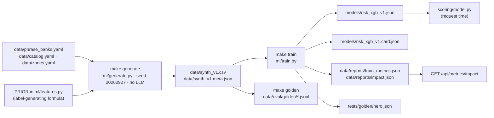

# Machine learning

Wasel has one trained risk model and one small text classifier. This page covers the risk model in full: what it predicts, the synthetic data it is trained on, how it is trained, how it is used at request time, and how to retrain it. The text classifier that checks outgoing drafts is described in [outbound](subsystems/outbound.md#2-guard-classifier).

**Read this first.** The model is trained on synthetic data whose labels were drawn from a hand-written formula. Its metrics show that it recovers that formula. They are not evidence about real refusal behaviour, and nothing in this repository has been validated against real orders.

## What the model does

It maps six features of an order to a probability that the delivery is refused. The score shown to a seller is 100 times that probability, adjusted by reply rules. The model is a monotone gradient-boosted classifier (XGBoost): each feature is constrained to push the score in one direction, so behaviour is auditable. A more specific address can never raise the score, and a higher price, more flags, a more negative tone, a more rural zone or a worse refusal history can never lower it.

| Feature | Constraint | Where it comes from at request time |
|---|---|---|
| `address_specificity` | decreasing | verified address level of the extraction |
| `red_flag_count` | increasing | verified, deduplicated, unresolved flags |
| `tone_score` | increasing | tone after the evidence-based tone gate |
| `price_tnd` | increasing | seller-entered price or catalog price × quantity |
| `zone_encoded` | increasing | seller-entered zone or the gazetteer |
| `customer_refusal_rate` | increasing | the customer's delivered and refused counts |

The feature contract (names, order, constraints, encodings) is defined once in `src/wasel/ml/features.py`; the generator, the trainer and the serving code all import it. Feature provenance and imputation are covered in [scoring](subsystems/scoring.md#features). Only `features.py` is used at request time; the rest of `src/wasel/ml/` is offline.

## Lifecycle

## Training data

### How rows are generated

`python -m wasel.ml.generate --seed 20260927 --n 10000` (`make generate`) draws 10,000 synthetic orders. One row is one order at its first scoring: customer text only, no seller line. The generator makes hidden attributes first and the label second, and text last:

1. **Latent attributes.** Zone (urban 55%, suburban 30%, rural 15%), a place in that zone from the gazetteer, address level (distribution depends on zone; rural addresses are vaguer), a product from the 15-item catalog (weighted), quantity (1 for 85%), customer history (number of past orders and refusals), tone, language, and which red flags are present (flag probabilities depend on address level and tone). All probabilities are constants in `generate.py`.
2. **The label.** From the six features the generator computes a risk index `S` and a probability `p_true`, and draws `refused ~ Bernoulli(p_true)`:
   - `S = 100 × (0.35 × (1 − address_specificity) + 0.15 × price_scaled + 0.10 × zone/2 + 0.20 × refusal_rate + 0.10 × min(flags, 3)/3 + 0.10 × tone_weight)`, where `price_scaled` is the price on a log scale between 20 and 600 TND clipped to [0, 1] and `tone_weight` is 0, 0.25, 0.75, 1.0 for positive, neutral, uncertain, negative;
   - `p_true = 1 / (1 + exp(−(S − 43) / 12))`.
   These constants are the `PRIOR` in `features.py`. They are assumptions, not estimates from data.
3. **Text.** Customer messages are assembled from the authored phrases in `data/phrase_banks.yaml` (Arabizi, Arabic-script Darija and French, plus a `mixed` language composed from those), with the ground-truth address phrase, flags and tone recorded. The renderer never sees `S`, `p_true` or `refused`, so the label never depends on the text and the text never depends on the label.

Random streams for rows, split, evaluation subset and text are independent, so editing a phrase bank changes only the text columns and not the labels.

### Splits and columns

`data/synth_v1.csv` has 10,000 rows (5.7 MB). 8,000 are `train`, 2,000 are `holdout` (7,999 and 2,001 after a stratified split on refusal and zone). The overall refusal rate is 0.2995. A further 40 holdout rows form the evaluation subset: their text is drawn from the `eval_only` phrase pool that the rules extractor does not use. All other rows draw from the `train` pool.

Columns include the six features, the categorical context (`zone`, `governorate`, `place_name`, `address_level`, `product_id`, `product_category`, `quantity`, `tone`, `language`), the ground truth (`flags_gt`, `S`, `p_true`, `refused`), `split`, `eval_subset`, `text_pool`, and the rendered text (`messages_json`, `text`, `gt_evidence_json`). The training script uses only the six feature columns and `refused`; it asserts that `S` and `p_true` are not among the inputs.

### Generator checks

`make generate` refuses to write anything if a lint fails: split sizes of each phrase cell, label words in phrases, one phrase under two labels, `exact` phrases that fail (or `street_and_landmark` phrases that pass) the exact-address guard, evaluation-only phrases leaking into the prompts, overlap between tone and flag phrases, planted phrases that cannot be found in their row's text, and a refusal base rate outside 0.25 to 0.35.

`data/synth_v1.meta.json` records the seed, row count, base rate, split counts and SHA-256 of the CSV, the three data files and `features.py`, and the git commit at generation time.

## Training

`python -m wasel.ml.train` (`make train`) fits an `XGBClassifier` on the training rows with these parameters (also stored in the card): `binary:logistic`, 400 trees, learning rate 0.05, depth 2, `min_child_weight` 10, `subsample` 0.8, `reg_lambda` 1, `hist` tree method, `random_state` 42, one thread, and `monotone_constraints` from the feature contract. Depth 2 and no tuning are deliberate: the generating prior is additive in log-odds, so the model class already matches it.

The holdout rows are used for evaluation, never for fitting. The trainer checks three gates and exits non-zero if any fails (the artifacts are written before the check, so a failed run still overwrites files):

| Gate | Condition |
|---|---|
| AUC | at least 0.70 and within 0.03 of the oracle AUC (the AUC of `p_true` itself) |
| Calibration | mean absolute error between predicted and true probability at most 5 points |
| Tier ordering | the observed refusal rate rises from `low` to `medium` to `high` tier on the holdout |

### Committed results

From `data/reports/train_metrics.json` (holdout, 2,001 rows):

| Metric | Value |
|---|---|
| AUC | 0.7844 (oracle 0.7832) |
| Brier score | 0.1619 (oracle 0.1623) |
| Calibration error | mean 2.41 points, max 16.88 |
| Tier share (low / medium / high) | 65.5% / 25.8% / 8.7% |
| Observed refusal rate by tier | 15.9% / 49.6% / 77.6% |

The model scores about the same as the oracle, which is what one expects when the model recovers the formula that produced the labels. It says nothing about how well the formula matches reality. The card also carries a reliability table (predicted against observed rate per decile), which shows the largest deviations in the 0.6 to 0.9 bins where there are few rows.

### Simulated impact

`impact.json` combines the holdout predictions with the `roi` assumptions in `scoring.yaml`: a failed trip costs 8 TND, a confirmation question prevents 30% of refusals in the orders it is asked of, a prepayment request prevents 60% but loses 10% of the good orders at a 25% margin. On the holdout this projects the refusal rate falling from 29.99% to 23.58%, 128.1 trips avoided and 928.1 TND saved (463.8 TND per 1,000 orders; 250.9 to 676.7 across confirmation effectiveness of 15% to 45%). Every input is an assumption and the outcome labels are simulated. The API returns this as `simulated: true`, and the UIs label it that way.

## Model artifact and card

| File | Content |
|---|---|
| `models/risk_xgb_v1.json` | The XGBoost booster (about 290 KB). Loaded from `model.file` in `scoring.yaml`. |
| `models/risk_xgb_v1.card.json` | Version `xgb_v1-<first 8 hex of the model SHA-256>`, parameters, feature order, monotone constraints, model and data SHA-256, generator metadata, library versions, training time, the reliability table and notes. |
| `data/reports/train_metrics.json`, `impact.json` | Metrics and simulated impact |
| `tests/golden/hero.json` | The sample order's frozen scores, reasons and diff |

Tests keep these consistent: the model file's hash must equal the card's, the card's feature order must equal the code's, the XGBoost minor version must match the card's (so upgrading the library needs a retrain and a new card), monotonicity is checked on a grid, and the training gates must be recorded as passing.

## Inference path

At request time `scoring/model.py` loads the booster once, builds one row in `FEATURES` order (never NaN) and calls `predict(pred_contribs=True)`. The output gives the probability and per-feature log-odds contributions. `scoring/reason.py` converts contributions into score points that sum exactly to the model score minus the base rate, and those points are what reasons and reason diffs are made of. No explanation library is used at runtime; XGBoost's own contribution output does the work. See [scoring](subsystems/scoring.md#reasons).

## Reproducibility

Verified by regenerating and retraining from a clean checkout:

- `make generate` reproduces `data/synth_v1.csv` byte for byte. `data/synth_v1.meta.json` records the SHA-256 of `features.py`, the banks, the catalog and zones, and the git commit at generation time, so it shows a diff after any edit to those files or any new commit. Regenerate it in the same change as such an edit.
- `make train` reproduces `models/risk_xgb_v1.json` and `tests/golden/hero.json` byte for byte. It also rewrites `created_at` and `trained_at` timestamps in `train_metrics.json`, `impact.json` and the card, so those three files show a diff on every run even when nothing else changed.
- Determinism relies on the pinned versions in `requirements.txt`, fixed seeds and single-threaded training.

## Retraining

Retrain when the feature contract, the prior, the catalog or the zones change, when the XGBoost version changes, or (the real reason to retrain) when real outcomes are available.

1. Change the inputs: `data/catalog.yaml`, `data/zones.yaml`, `data/phrase_banks.yaml`, or `PRIOR` and the generator distributions. A change to a `PRIOR` constant or a feature means regenerating and retraining, as the file header of `features.py` says.
2. `make generate`. It fails on lint errors.
3. `make train`. It fits the model in a temporary directory and writes the model, card, reports and hero golden only if the three gates pass; on a failure it prints the metrics, exits 1 and leaves every tracked file unchanged. Read the printed metrics and the three gates. Compare `data/reports/train_metrics.json`, `impact.json`, the card and `tests/golden/hero.json` in `git diff`.
4. `make golden` (the golden extraction set is drawn from the holdout rows), then `python -m wasel.monitor --build-reference`, then `make eval`.
5. `make test`. The hero test pins the sample order (87 to 16); if the model change moves it, decide whether the new values are the intended behaviour and update the pinned golden, never the reverse.
6. Commit the CSV, model, card, reports, golden files and reference together.

To train on real outcomes, replace `data/synth_v1.csv` with a table having the same six feature columns, `refused`, and a `split` column, keep the gates, and remove or reinterpret the simulated-impact and calibration-against-oracle logic, which assume `p_true` exists. There is no such pipeline yet.

## Known limitations

- Labels are simulated. Feature weights, zone risk and catalog prices are assumptions.
- `zone_encoded` raises the score of rural orders by construction. An expected-failure test records that a rural order with an exact address and a 450 TND price scores 36.3 (medium) on the committed model, against 30.8 for the simulated maximum and 29.0 for the prior. Resolving it means changing the data or accepting the trade-off in the card, not tuning the model until the test passes. The limitation is recorded in the `notes` of `models/risk_xgb_v1.card.json`.
- Confidence is an operational rule ([scoring](subsystems/scoring.md#confidence)), not a calibrated interval.
- The 0.6 confirmation multiplier and the 15 point timeout addition are starting assumptions, not fitted.
