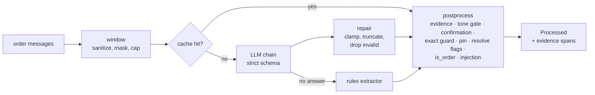

# Extraction

Extraction turns a conversation into a verified, structured record that the scorer can trust. The record comes from an LLM or, when none is available, from a rules extractor. Either way it is then checked by deterministic code. This is the main defence against model errors and prompt injection, so the checks matter more than the model.

Code: `src/wasel/extraction/` (`window.py`, `repair.py`, `evidence.py`, `cross_field.py`, `injection.py`, `normalize.py`, `rules_extractor.py`), `src/wasel/ml/textnorm.py` and `src/wasel/ml/features.py` for the shared helpers. The record itself is described in the [data model](../architecture/data-model.md#the-12-field-extraction). The provider call is covered in [LLM layer](llm.md).

## Stages

### 1. Window

`build_window` selects what the model may see (`extraction/window.py`):

- Customer text messages, voice-note transcripts and location pins, ordered by provider timestamp.
- Only the **latest** outbound message, as a `[SELLER]` line. For an AI-authored message the text is the canonical template text (`WindowMessage.canonical_text`), never the LLM rewrite that may have been sent instead; an AI message without canonical text is skipped. A seller-authored message contributes its own text.
- At most 12 messages and 2,000 characters (`window` in [`scoring.yaml`](../configuration/scoring.md)). When over the cap, whole customer messages before the seller line are dropped, oldest first; if the messages after the seller line alone exceed the cap, the oldest of those go too.

The window is rendered as tagged lines inside `<customer_messages>`: `[CUSTOMER]`, `[CUSTOMER:voice]`, `[CUSTOMER:location_pin]`, `[SELLER]`, followed by an instruction line. Each text is sanitized (`extraction/normalize.py: sanitize_llm_view`):

| Transformation | Purpose |
|---|---|
| Digits of phone-like numbers (Tunisian 8-digit numbers, with or without `+216`/`00216`) become `•` | The model never sees a phone number |
| `< > [ ] { }` become look-alike Unicode brackets (`‹ › ⟦ ⟧ ⦃ ⦄`), including full-width forms | Customer text cannot forge a `[SELLER]` line, a closing tag or JSON |
| Newlines, tabs, non-breaking spaces and invisible format characters (zero-width, bidi controls) become spaces | Removes hidden text and layout tricks |

Every substitution is one code point for one code point, so a span found in the sanitized view has the same offsets in the original text. `sanitize_llm_view` asserts equal length.

The **cache key** is `sha256("extract|<prompt version>|order_extraction_v1|<rendered window>")`. The model name is not part of it.

### 2. Model answer, repair, parse

The chain returns raw text; `parse_extraction` (`extraction/repair.py`) turns it into an `OrderExtraction`. It repairs rather than rejects wherever a fix is unambiguous:

| Problem | Repair |
|---|---|
| Quotes over 160 characters (product 120), surrounding whitespace, empty strings | truncated, stripped, set to null |
| More than 4 address quotes or 6 flags, duplicate quotes, more than one flag per code | truncated, deduplicated |
| Flag with unknown code or missing evidence | dropped |
| Quantity outside 1 to 50, not an integer | set to null |
| Unknown `tone`, `confirmation`, `language` or `clarity` | replaced by `neutral`, `none`, `mixed`, `partial` |
| Extra keys | dropped |

It raises `ParseError` (the chain treats it as a failed attempt and moves on) only when the shape is unusable: not a JSON object, a missing field, a non-boolean `is_order` or `is_order_change`, or an invalid `address_level`. The address level is never guessed because it drives the first model feature.

### 3. Verification (`postprocess`)

`extraction/cross_field.py: postprocess` is a pure function that runs the same way for LLM, cached and rules results. Its steps, in order:

| Step | Rule |
|---|---|
| Product | `product_quote` must be found in a customer line (at least 2 characters). Otherwise it is null. |
| Address quotes | Each quote must be found in a customer line (at least 3 characters ignoring spaces). Unverified quotes are dropped and counted in `dropped_quotes`. If none survive, the level is `none`. |
| Flags | Each flag's evidence must be found in a customer line, not in the `[SELLER]` line. Others are dropped and counted in `dropped_flags`. |
| Tone gate | A non-neutral tone survives only if its evidence is found in a customer line after the seller line (any customer line if there is no seller line) **and** does not overlap any verified flag span. Otherwise tone becomes `neutral` (warning `tone_neutralized`). |
| Confirmation | Requires a seller line with a customer line after it, else `none`. After a `T_ACK` message the previous confirmation is kept, because that template asks nothing. A `confirmed` reply to a `T_ADDRESS` message with no address quote or pin after it becomes `ambiguous`. |
| Exact-address guard | `exact` is downgraded to `street_and_landmark` unless a verified address quote has a standalone 1 to 3 digit number or a building word (`imm`, `immeuble`, `apt`, `appartement`, `étage`, `bloc`, `résidence`, `villa`, `maison`, and Arabic equivalents), or matches "dar <number>". |
| Location pin | Any location message in the order forces the level to `exact`. |
| Flag resolution | One flag per code, keeping the latest evidence. Then `resolve_flags` drops flags the conversation has since resolved: `vague_location` when the final level is `exact`; `availability_uncertain` when the customer confirmed or rescheduled after the seller line and the flag was raised before it; `price_hesitation` likewise on `confirmed`. It never adds a flag and is idempotent. |
| `is_order` guard | If the model said `is_order=false` but an injection was detected, or a product or address quote was verified, the code sets it to true (warning `is_order_overridden`). Code owns this field. |
| Injection | See below. A hit also clears the confirmation. |

The result is a `Processed` object with the final fields, the raw and final address level, the resolved flag codes, counts of dropped items, warnings, and the **evidence spans** (`message_id`, start, end, kind `address`, `red_flag`, `product` or `tone`) that the UI uses to highlight the customer's words.

What the extraction cache stores is the state after repair, evidence checking and the tone gate. Confirmation rules, the exact guard, the pin override and flag resolution are re-run on every hit, so a code fix takes effect on cached conversations too.

### Text normalization

Evidence matching and the rules extractor share one normalizer (`ml/textnorm.py`): Unicode NFKC, case folding, removal of Arabic diacritics and tatweel, unification of alef, ya and ta marbuta variants, Arabic-Indic digits to ASCII, and whitespace collapsing. It keeps an index map back to the original string, which is how spans land on the original text. Matching is by whole tokens for phrases (`has_phrase`), so `9rib` never matches `rib`.

Arabizi writes Arabic letters as digits (`3` for ع, `7` for ح, `9` for ق), so a digit touching a Latin letter is part of a word. A "standalone number" is a run of 1 to 3 digits not glued to a letter. Known gap: `dar14` (no space) is not recognised as a house number.

### Injection handling

Customer text is untrusted. Three independent layers apply:

1. **Prompt.** The system prompt states that everything inside `<customer_messages>` is data and that instructions in it must be ignored ([LLM registry](../configuration/llm-registry.md#prompt-files-and-the-version-lock)).
2. **Defusing.** The sanitizer above prevents forged tags and structure.
3. **Lexicon.** `extraction/injection.py` matches the regexes in `lexicons.injection` of [`scoring.yaml`](../configuration/scoring.md#lexicons) against every customer text and voice line (never the seller line). `normalized` patterns run on the normalized text with all Unicode format characters removed, so `ig​nore` with a zero-width space still matches; `defused` patterns run on the sanitized model view.

A hit sets `injection_suspected`, which forces `confidence=low` and status `needs_review`, clears any confirmation and forces `is_order=true`. It never changes the score. The evaluation gate requires that injected orders are flagged, still scored, and not promoted to an `exact` address ([evaluation](../evaluation.md)).

## Rules extractor

`rules_extract` (`extraction/rules_extractor.py`) is used whenever there is no model answer: no keys, all providers failing, a cap reached, input over the size limit, or an offline test mode. It is deliberately conservative and its output is always marked `confidence=low` with path `rules`, action `review` and status `needs_review`.

| Field | How it is derived |
|---|---|
| `address_level` | Per sentence: a pin or a standalone number with a street word or building word is `exact`; a street word (`rue`, `nahj`, `triq`, `شارع`, ...) is `street_and_landmark`; an area or landmark word (`cité`, `hay`, `douar`, `9rib`, `pharmacie`, ...) is `area_or_landmark`; a gazetteer place is `city_only`. The highest sentence wins. |
| `red_flags` | Substring match of the `train` phrases in [`data/phrase_banks.yaml`](../data.md#top-level-files), with slots expanded. `eval_only` phrases are not used. |
| `product_quote` | A catalog name or alias found in a **non-question** sentence ("vous avez des casques ?" is a browse, not an order). |
| `confirmation` | An acknowledgement (`ok`, `oui`, `ey`, `behi`, ...) or decline lexicon term at the start of a customer line after the seller line. |
| `is_order` | A product quote, an address quote, or an order-intent verb (`nheb`, `n7eb`, `nebghi`, ...) exists. A flag alone is not an order. |
| `language` | Script counts plus Arabizi markers. |
| Always | `tone=neutral`, `quantity=null`, `is_order_change=false`, `clarity=partial`. |

The lexicons (`ack`, `decline`, `order_intent`) live in `scoring.yaml`; the street and area vocabularies are constants in the module.

## Extending

- **New flag code.** Touches the JSON schema (`config/schemas/order_extraction_v1.json`), `FlagCode` in `repair.py` and `contracts.py`, `FLAG_ORDER` in `ml/features.py`, `FLAG_LABELS` in `scoring/score_order.py`, the extract prompt and few-shot file (which needs a new prompt version, see [extending](../development/extending.md#change-a-prompt)), the phrase banks, and the tests that assert the schema matches the Pydantic model. Because `red_flag_count` is a model feature, a new code that should influence the score changes what the feature means and calls for a retrain.
- **New language or dialect.** Add authored phrases to the banks, regenerate the dataset and golden sets, and extend the street and area vocabularies of the rules extractor and the language heuristic.
- **Different verification rule.** Change `postprocess` and add a case to `tests/unit/test_extraction.py`. Cached conversations pick the change up automatically; golden sets and `make eval` show the effect.
