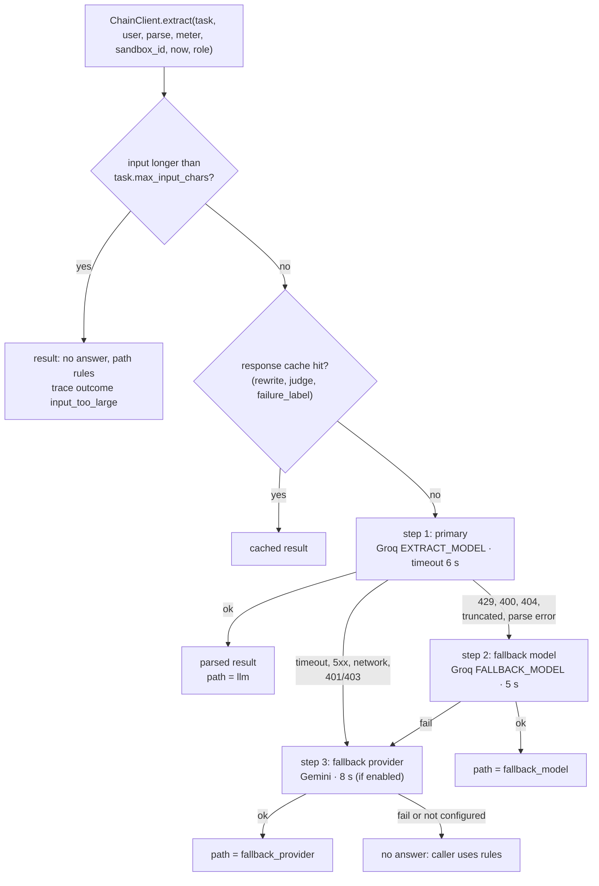
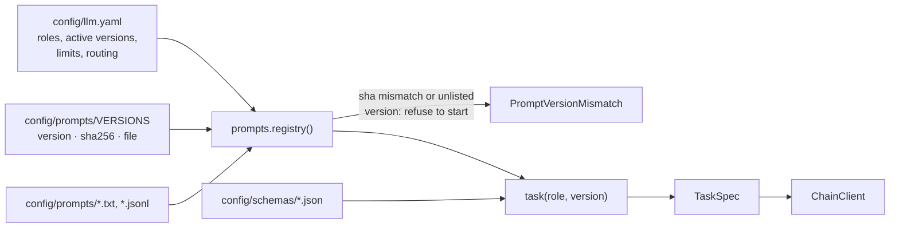

# LLM layer

Wasel uses language models for three narrow jobs and keeps everything else deterministic. This page explains the client abstraction, how providers and prompts are configured, what happens when a call fails, and how to run without any provider.

Code: `src/wasel/llm/` (`client.py`, `groq_backend.py`, `gemini_backend.py`, `schema_gemini.py`, `prompts.py`, `base.py`, `trace.py`), `src/wasel/db/usage.py` for caps. Configuration files: [`config/llm.yaml`](../configuration/llm-registry.md), `config/prompts/`, `config/schemas/`.

## Where a model participates

| Job (role) | Runs when | What the model returns | Who decides |
|---|---|---|---|
| `extract` | Every scoring of a conversation that is not in the extraction cache, and a provider is configured and within its caps | The 12-field extraction as strict JSON | Code verifies every quote and rule ([extraction](extraction.md)) and then scores. |
| `rewrite` | Only with `DRAFT_LLM=true` | A reworded version of an approved template | Prefilter, local classifier and judge can each veto it ([outbound](outbound.md)). |
| `judge` | Only with `DRAFT_LLM=true`, after a rewrite passes the prefilter and the classifier | A structured review of the rewrite | Approval is recomputed in code from the returned fields; the model's `verdict` alone is never enough. |
| `failure_label` | Only in the failure analyzer's `--llm` mode | Labels for agent conversation messages | Rules cover anything unlabeled ([failure analysis](failure-analysis.md)). |

Two developer scripts also call a provider directly: `scripts/data/warm_cache.py --live` records real extractions for the sample orders, and `scripts/data/expand_phrase_bank.py` drafts paraphrases for the phrase banks. Neither runs in the application.

Everything else is deterministic, including the score, the tier, the action, the reason text, the order status, the price, the zone, the template choice and every safety decision except the judge's opinion. No model output is ever used as a number the UI displays.

## The client

`ChainClient` (`llm/client.py`) is the only place a provider is called. `make hygiene` fails if code outside `src/wasel/llm/` imports a provider SDK, and no SDK is used at all: providers are reached with plain `httpx` requests.



`extract()` is generic despite its name: it takes a `TaskSpec` (system prompt, few-shot pairs, response schema, limits), the user text and a `parse` function, and returns a `ChainResult` with the parsed value (or `None`), the raw text, the path, provider, model, per-attempt outcomes, `UsageRecord`s for every attempt, and `cap` if a usage cap stopped it. Rewrite, judge and failure labelling use the same entry point with their own tasks.

Rules of the walk (`ChainClient._run`):

- **No retries and no sleeps.** Each step is tried at most once per call.
- **Deadline.** The whole chain has `LLM_DEADLINE_S` (28 s by default, `routing.deadline_s` in `config/llm.yaml`; it must be longer than the AMD Token Factory step plus the Groq backup). A step whose timeout does not fit in the remaining time is skipped.
- **Circuit breaker.** After a `ProviderDown` the provider is skipped for 60 seconds. The breaker is per provider, so it covers both Groq steps.
- **Sibling skip.** A timeout or `ProviderDown` on the primary also skips the same-provider fallback model, since a slower or down provider will not answer the smaller model faster.
- **Caps.** Before each step that would make a call, the client asks the usage meter. A refusal ends the chain at once with `cap` set. It is not an error.
- **Parsing is inside the step.** `parse(raw)` runs as part of the attempt, so a response that fails validation counts as a failed attempt and the chain moves on.

### Error taxonomy

Backends raise subclasses of `LLMError` (`llm/base.py`). The recorded `outcome` is what appears in `llm_usage.outcome`, in traces and in the extraction run's attempts:

| Error | Raised for | Outcome | Chain reaction |
|---|---|---|---|
| `RateLimited` | HTTP 429 | `rate_limited` | next model |
| `SchemaRejected` | HTTP 400 and other 4xx | `schema_rejected` | next model |
| `ModelGone` | HTTP 404 (model unknown or retired) | `schema_rejected` (detail in the error string) | next model |
| `Truncated` | `finish_reason` other than `stop` | `truncated` | next model |
| `ParseError` | unreadable envelope, empty content, JSON or schema failure in `parse` | `parse_error` | next model |
| `Timeout` | request exceeded the step timeout | `timeout` | skip sibling model, go to next provider |
| `ProviderDown` | 5xx, network or DNS error, HTTP 401 or 403 | `down` | open the breaker, skip sibling model |
| `InputTooLarge` | defined for the input cap; the client enforces the cap itself and returns a rules result without raising it | | |
| `FixtureMissing` | not an `LLMError`: an offline replay client has no recording for the input | | propagates on purpose so an offline test fails loudly |

## Providers and backends

`OpenAICompatBackend` (`llm/groq_backend.py`) speaks the OpenAI chat-completions protocol: one `POST {base_url}/chat/completions` with the system prompt, the few-shot pairs as user and assistant turns, and the user text. The request asks for structured output (`response_format: {"type": "json_schema", "strict": true}`), sends `temperature` from the task, `seed: 7` where supported, the output limit in `max_completion_tokens`, and `reasoning_effort: "low"` for the gpt-oss models. The same class serves:

| Provider | Base URL | Notes |
|---|---|---|
| Groq | `https://api.groq.com/openai/v1` | Also sends the Groq-only `reasoning_format: "hidden"`. |
| Self-hosted (vLLM or any compatible server) | `GROQ_BASE_URL` | Chosen when the variable is set; the Groq-only field is dropped automatically because vLLM rejects unknown fields. `SELF_HOSTED_API_KEY` carries the server's token; without it, `GROQ_API_KEY` does. When `SELF_HOSTED_API_KEY` is set, `GROQ_API_KEY` is the hosted backup behind the server. See [self-hosted LLM](../operations/self-hosted-llm.md). |
| Gemini | `https://generativelanguage.googleapis.com/v1beta/openai/` | `schema_gemini.py` rewrites the strict schema into the subset the endpoint accepts. `config/probe.json` (`PROBE_FILE`) can describe the account's preferences (nullable style, token-limit field name, whether a seed is accepted); without it, built-in defaults apply. |

Which steps exist is decided by `config/llm.yaml` and the environment at start (`wasel.llm.routes.build_steps`). An endpoint with no key, or with no address where it takes one from a variable, is inactive and adds no step, so an unused endpoint never blocks startup. A role with no route of its own walks the `extract` route.

<!-- BEGIN GENERATED: llm-endpoints -->
| Endpoint | Protocol | Address | Key variable | Reasoning | Active when |
|---|---|---|---|---|---|
| `groq` | openai-compatible | `https://api.groq.com/openai/v1` | `GROQ_API_KEY` | hosted_groq | its key is set |
| `self-hosted` | openai-compatible | `GROQ_BASE_URL` | `SELF_HOSTED_API_KEY`, `GROQ_API_KEY` | self_hosted | its key is set, `GROQ_BASE_URL` is set |
| `amd-tokenfactory` | openai-compatible | `AMD_TOKENFACTORY_BASE_URL` | `AMD_TOKENFACTORY_API_KEY` | self_hosted | its key is set, `AMD_TOKENFACTORY_BASE_URL` is set, `AMD_TOKENFACTORY_MODEL` is set |
| `gemini` | gemini | built in | `GEMINI_API_KEY` | none | its key is set, `GEMINI_MODEL` is set, `GEMINI_ENABLED` is true (off by default) |

| Route | Step | Endpoint | Kind | Model | Timeout | Skipped when |
|---|---|---|---|---|---|---|
| `extract` | 1 | `amd-tokenfactory` | `primary` | `endpoint` | 16s | never |
| `extract` | 2 | `self-hosted` | `primary` | `primary` | 6s | never |
| `extract` | 3 | `self-hosted` | `fallback_model` | `fallback` | 5s | `GROQ_FALLBACK_ENABLED` is false |
| `extract` | 4 | `groq` | `primary` | `primary` | 6s | `self-hosted` or `amd-tokenfactory` is active |
| `extract` | 5 | `groq` | `fallback_model` | `fallback` | 5s | `GROQ_FALLBACK_ENABLED` is false, `self-hosted` or `amd-tokenfactory` is active |
| `extract` | 6 | `groq` | `fallback_provider` | `primary` | 8s | `self-hosted` is active, `amd-tokenfactory` is inactive |
| `extract` | 7 | `groq` | `fallback_provider` | `primary` | 8s | `SELF_HOSTED_API_KEY` is unset |
| `extract` | 8 | `gemini` | `fallback_provider` | `endpoint` | 8s | never |
<!-- END GENERATED: llm-endpoints -->

The tables above are generated: run `python scripts/dev/gen_llm_docs.py` after editing `endpoints` or `routes`. A test fails when they drift from the config.

- **Model names** come from `EXTRACT_MODEL` (else `routing.primary` in `llm.yaml`) for `primary`, and `FALLBACK_MODEL` (else `routing.fallback_model`) for `fallback`. `endpoint` means the model named by the endpoint's own `model_env` (Gemini, AMD Token Factory).
- **No key at all** yields an empty chain: every extraction goes straight to the rules extractor. That is the intended offline behaviour, not a misconfiguration.

### Add an endpoint

A second host is configuration only: no change to `client.py`, `contracts.py`, `api/models.py` or `db/schema.sql`. The stored `provider` stays `groq` for any OpenAI-compatible server, and the new `endpoint` column in `llm_usage` and `extraction_runs` records which deployment answered.

1. Add the endpoint under `endpoints:` in `config/llm.yaml`. Name the variables that hold the address and key. Never write a key or a host address in the file.

   ```yaml
   amd-b:
     protocol: openai-compatible
     base_url_env: AMD_B_URL
     key_env: AMD_B_KEY
     reasoning: self_hosted
   ```

2. Add a step to a route under `routes:` (usually `extract`, before the step it should come ahead of).

   ```yaml
   - { endpoint: amd-b, kind: primary, model: primary, timeout_s: 6 }
   ```

3. Set the variables in `.env` or the host's environment, then restart: `AMD_B_URL=http://10.0.0.5:8000/v1` and `AMD_B_KEY=<token>`.
4. Run `python scripts/dev/gen_llm_docs.py` to refresh the tables above, then `make check`.
5. Confirm with `GET /api/health`: `llm.chain_extract` lists the new step and `llm.observed` gains an `amd-b` row after its first recorded call.

A new wire protocol (not OpenAI-compatible) is a code change: one adapter in `ADAPTERS` and one entry in `PROTOCOLS` in `llm/routes.py`.

The provider variables are read when the app starts, from the process environment and then from `.env` ([environment](../configuration/environment.md#how-values-are-loaded)). The chain is built once, so changes need a restart.

## Prompt registry

Which prompt, schema and limits each role uses is data, not code.



- `registry()` parses `llm.yaml`, then checks every file in `config/prompts/VERSIONS` against its SHA-256 and checks that each role's `active` version and every listed version are locked to the right file. Any inconsistency raises `PromptVersionMismatch` when `wasel.llm.prompts` is imported, so the app cannot start with a prompt that changed silently.
- `task(role, version)` reads the system prompt, the few-shot file (extract only) and the JSON schema, and applies the role's limits.
- The extract role's active version can be overridden with `PROMPT_VERSION`; the other roles cannot.
- `python scripts/ops/rollback.py <role> <version>` rewrites one `active:` line in `llm.yaml`. Commit, restart, and run `make eval`.

Prompt files, schemas and versioning are documented in [configuration/llm-registry.md](../configuration/llm-registry.md).

## Structured outputs

Every role has a strict JSON schema in `config/schemas/` (`additionalProperties: false`): `order_extraction_v1` (12 fields), `outbound_rewrite_v1` (`{"text"}`), `outbound_judge_v1` (`unsupported_claims`, `grounded`, `language_ok`, `tone_ok`, `overreach`, `question_count`, `verdict`) and `failure_label_v1` (`{"items": [...]}`). The provider enforces the schema where it can; Wasel validates again regardless. For extraction the Pydantic mirror in `extraction/repair.py` is checked against the JSON file by a test, so the two cannot drift.

## Tracing

Every call through `ChainClient.extract` emits one trace record (`llm/trace.py`): trace id, role, prompt version, schema, a 16-character hash of the input, input size, outcome (`ok`, `failed`, `cap`, `cache_hit`, `input_too_large`), path, provider, model, attempts, latency, token counts and the order id and sandbox id bound by the scorer or drafter. Traces never contain customer text or phone numbers. Rewrite and judge outputs are kept, because they contain shop text only and the monitor and analyzer read verdicts from them.

Records go to an in-process ring buffer of 5,000 entries (read by `GET /api/traces` and `/api/monitor`) and, if `TRACE_FILE` is set, are appended to that file as JSON lines. The buffer is lost on restart. The persistent record of provider calls is the `llm_usage` table.

## Caps and the usage meter

`SqliteUsageMeter` (`db/usage.py`) implements the `UsageMeter` protocol over `llm_usage`, so counters survive restarts. `allow()` returns `ok`, `global_cap` or `visitor_cap`:

| Limit | Default | Applies to |
|---|---|---|
| Provider calls per UTC day, all roles and providers, including fallback hops and failed attempts | public 80, event 300, dev unlimited; override with `LIVE_LLM_DAILY_CAP` (0 disables live calls) | everyone |
| Tokens per model per UTC day | 120,000 | public mode only |
| Calls per visitor per 10 minutes | 6 (`VISITOR_LLM_CAP_10MIN`) | public mode, sandbox traffic |
| Calls per visitor per UTC day | 20 (`VISITOR_LLM_CAP_DAY`) | public mode, sandbox traffic |
| Calls per client address per UTC day | 25% of the daily cap (`ADDR_LLM_SHARE`), shared by every visitor id seen from that address | public mode, when the address is known (`CLIENT_IP_HEADER`); the id-to-address map is in memory, so a restart forgets it |

Calls approved during a scoring run but not yet written to `llm_usage` are held as reservations, so a three-step chain cannot overshoot the limit. The worker calls `settle()` after its transaction. The failure analyzer's `--llm` mode passes no meter and is not capped.

## Test and drill modes

`LLM_MODE` replaces the live providers with test doubles behind the same `ChainClient`:

| Mode | Chain | Use |
|---|---|---|
| `live` (default) | real providers, per the environment | production, live evaluation |
| `replay` | one primary step served from recorded fixtures | offline tests |
| `fail_primary` | primary always answers 429, the fallback model replays | fallback drill |
| `fail_groq` | both Groq steps answer 5xx, Gemini replays | provider-outage drill |
| `fail_all` | every step fails | fully offline behaviour: everything lands on the rules path |

`make test`, `make eval` and `make drill` run with `LLM_MODE=fail_all`. Fixtures are JSON envelopes keyed by the SHA-256 of the rendered window (`meta`, `key`, `window`, `status`, `response`). `ReplayBackend` ignores fixtures marked `source: hand_crafted` unless a test asks for them. `LLM_MODE=replay` loads fixtures from `LLM_REPLAY_DIR` (default `data/llm_replay`) and refuses to start if that directory holds no `*.json` files. The repository ships no recordings and no command that records; you supply envelopes yourself (the tests build them with the `replay_dir` helper in `tests/conftest.py`). A request with no matching fixture raises `FixtureMissing`, a deliberate loud failure.

## When the LLM is unavailable

| Situation | Outcome |
|---|---|
| No API key | Empty chain, rules extractor, every new order `needs_review`. Seeded orders still work through the extraction cache. |
| Provider outage, rate limiting, timeouts | Fallback steps, then rules. Recorded with an `llm.fallback` event; `/api/health` reports `status: degraded` and `fallback_active: true` for the next five minutes. |
| Cap reached | Rules, `llm.cap_reached` event, `confidence=low`. |
| `DRAFT_LLM=true` and the rewrite call fails | The static template is used and needs a person ([outbound](outbound.md)). |
| `DRAFT_LLM=true` and only the judge fails | The draft goes to a person unless the classifier alone clears it and the gate is `classifier` ([outbound](outbound.md#routing)). |
| Extraction cache hit | No call at all. |

## Extending

- **New role.** Add a prompt and a schema file, a `roles:` entry with limits in `llm.yaml`, a line in `VERSIONS`, and a `parse` function; call `llm.extract(task("role"), ...)`. Add the role to the `Role` type in `contracts.py` and to the check constraint on `llm_usage.role` if it goes through the meter.
- **New provider.** Any OpenAI-compatible endpoint is a [config entry](#add-an-endpoint). A provider with a different wire protocol needs a backend with `complete_json(task, model, user, timeout_s) -> (raw_text, CallMeta)` that raises `LLMError` subclasses.
