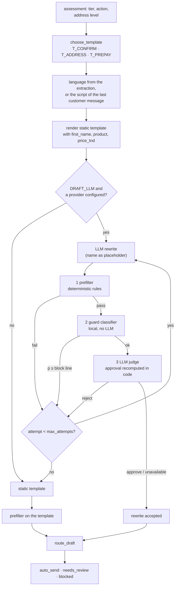

# Outbound drafts

When an order is worth a question, Wasel prepares the message and decides who may send it. This page covers template selection, the optional LLM rewrite, the three checks a rewrite must pass, routing, and sending. The design goal is that no message reaches a customer unless a person sends it or an explicitly enabled, conservative gate clears it.

Code: `src/wasel/outbound/` (`templates.py`, `make_draft.py`, `prefilter.py`, `guard_clf.py`, `judge.py`, `route.py`, `whatsapp_send.py`), `worker.py` (draft creation), `api/commands.py` (sending). Templates: [`data/templates/outbound.yaml`](../data.md#top-level-files). Thresholds: `outbound` and `auto_send` in [`scoring.yaml`](../configuration/scoring.md).

## Flow

`make_draft(req, llm, meter, config)` is pure: it returns a `DraftRecord`, and the worker persists it. With no LLM client it returns the static template checked by the prefilter.

## Templates

`data/templates/outbound.yaml` holds four templates, each in French, Arabizi and Arabic-script Darija, with a `text` variant (uses `{first_name}`) and a `no_name` variant:

| Template | Purpose | Chosen when |
|---|---|---|
| `T_CONFIRM` | Ask the customer to confirm the order (product and price) | medium or high tier, address specific enough |
| `T_ADDRESS` | Ask for street name and house number | medium or high tier and the address level is `none`, `city_only` or `area_or_landmark` |
| `T_PREPAY` | Say payment is due before delivery and ask for agreement | action is `prepay` (high tier, price ≥ 250 TND) |
| `T_ACK` | Acknowledge a confirmation, no question | never chosen by the scorer; the extraction still understands it if such a message is present |

Low-tier orders get no message. `expected_questions` in the file states how many questions each template asks (`one`, or `none` for `T_ACK`); the prefilter enforces it on rewrites. The file's `language_fallback` block is documentation only: the routing logic is `template_language` in `templates.py`. `fr` and `arabizi` map to themselves, `ar` and `darija_arabic_script` to the Arabic-script variant, and `mixed` to the script of the last customer message (Arabic script if more than half of its letters are Arabic, Arabizi if it has Arabizi markers, else French).

Slots come from the order and customer records only, never from customer text: `first_name` (first word of the display name if it consists of 1 to 20 Latin or Arabic letters, spaces or hyphens, otherwise the `no_name` variant), `product` (catalog name) and `price_tnd` (formatted without trailing zeros).

## LLM rewrite

Only with `DRAFT_LLM=true`, and only if the chain has at least one step. The rewrite prompt (`rewrite-v2`) receives the approved template text, the slot values, the language, a formality (`formal` or `informal`), an expected-question flag and, on a second attempt, the reasons the previous attempt was rejected. It returns `{"text": ...}`.

- The customer's name is replaced by the literal placeholder `{first_name}` before the call and substituted back by code afterwards. Personal data never reaches the model. A rewrite that does not contain the placeholder exactly once is rejected.
- Formality is `formal` for French unless recent customer lines exist and none of them uses "vous"; Darija and Arabizi are always `informal`.
- No customer text is sent to the rewrite or the judge, only the shop's own template and slot values.
- At most `outbound.judge.max_attempts` (2) rewrites are made. Anything that does not pass falls back to the static template.

## The three checks

Each check can only remove approval. They run cheapest first.

### 1. Prefilter

`prefilter()` (`outbound/prefilter.py`) is deterministic. It runs on every rewrite and on every static template (a test proves the templates pass). It returns failure codes; any failure rejects the draft:

| Code | Meaning |
|---|---|
| `slot_missing:<slot>` | a required slot value does not appear verbatim |
| `number_not_allowed:[...]` | a number that is not in the template or the price (Arabizi digits inside words are letters, not numbers) |
| `url`, `phone` | link-like text or a phone number |
| `payment:<term>`, `discount:<term>`, `promise:<term>` | a term from the `prefilter` lexicons in `scoring.yaml` that the template itself does not contain |
| `instructions_in_draft` | the injection lexicon matches the draft |
| `question_count:<n>` | more question marks than `expected_questions` allows, or any for a template that asks none |
| `too_long` | over `prefilter.max_chars` (400) |

### 2. Guard classifier

`outbound/guard_clf.py` is a local model with no LLM: character n-gram TF-IDF (2 to 5 characters, so Arabizi spelling variants are covered) and logistic regression, giving `p_unsafe` and the most likely unsafe class (`discount`, `payment`, `promise`, `instructions`, `contact`, `pushy`, `extra_question`). It is trained in process on first use, in well under a second, from [`data/draft_guard.yaml`](../data.md#top-level-files) plus the rendered static templates, with fixed seeds; there is no binary artifact. Because it never sees customer text and is not a language model, it cannot be prompt-injected.

`decide()` turns `p_unsafe` into a decision using the thresholds in `outbound.judge`:

| `p_unsafe` | Decision | Effect |
|---|---|---|
| ≥ `classifier_block_at` (0.5) | `block` | the rewrite is discarded, and the judge is not called |
| ≥ `classifier_hold_at` (0.1) | `review` | never auto-sent; a person decides |
| below | `send` | cleared |

`calibrate()` measures the decision on phrases the classifier never trained on and suggests the smallest hold line that clears at most 15% of unsafe text while holding at most 15% of safe drafts. The shipped 0.1 is that suggestion; a unit test pins it.

### 3. LLM judge

`outbound/judge.py` asks a model to review the draft against the order facts (`judge-v2` prompt, `outbound_judge_v1` schema). The judge sees the draft with the name as a placeholder and the order facts, including the approved template, and reports `unsupported_claims`, `grounded`, `language_ok`, `tone_ok`, `overreach` (`discount_or_price_change`, `payment_request`, `delivery_commitment`, `instructions_in_draft`, `other`, `none`), `question_count` and `verdict`. The application does not trust `verdict`: `approved_in_code` requires a verdict of approve, grounded, no unsupported claims, language and tone ok, no overreach, and the exact expected question count. Any call failure, cap or parse error makes the judge `unavailable`; it never raises.

The result, including the classifier decision, is stored in `outbound_drafts.judge_json` and summarised in `draft.judged` events.

## Routing

`route_draft()` returns one of three routes:

| Route | Meaning |
|---|---|
| `blocked` | the prefilter failed; the draft cannot be sent |
| `needs_review` | a person must click Send |
| `auto_send` | the system may send it without a click, if automatic sending is enabled |

Order of evaluation:

1. A failed prefilter is `blocked`.
2. A **static template is always `needs_review`**, so with `DRAFT_LLM=false` nothing is ever auto-sent.
3. For an LLM rewrite, the gate `auto_send.gate` decides whether it is cleared:
   - `classifier` (default): the classifier decision must be `send`. The judge still runs when available and its rejection still discards the rewrite, but its approval is not required.
   - `judge`: the judge must approve **and** the classifier must say `send`.
4. Even a cleared draft is `needs_review` unless the order's `confidence` is `high`, the price is known and at most `auto_send.max_tnd` (150), fewer than `auto_send.max_auto_messages_per_order` (2) automatic messages have been sent for this order, and the customer's last message is less than 24 hours old.

If the judge is unavailable and the classifier said `review` or `block`, the rewrite is dropped and the static template is used. If the judge is unavailable but the classifier said `send`, the rewrite is kept and, under the `classifier` gate, may auto-send.

## Sending

Drafts are created by the worker after a rescore that leaves the order `awaiting_reply` with no unsent draft, or by the seller action `request_confirmation`. Sending goes through `commands.send_draft`:

- `POST /api/drafts/{id}/send` is the human path. It needs write access to the order (not a read-only sample), and refuses a draft that was already sent (`409 ALREADY_SENT`) or is `blocked` (`409 DRAFT_BLOCKED`).
- A **real WhatsApp send** happens only if the conversation's channel is `whatsapp`, the mode is not public, `WA_SEND_ENABLED` is on, `WA_TOKEN` and `WA_PHONE_NUMBER_ID` are set, and the customer's last inbound message is under 24 hours old (WhatsApp's customer-service window; otherwise `409 OUTSIDE_24H_WINDOW`). The customer must have a phone number (`409 NO_RECIPIENT`). `WhatsAppSender` retries transient errors (network, 408, 429, 5xx) up to two extra times with exponential backoff and fails at once on other 4xx. A failure returns `502 WHATSAPP_SEND_FAILED`, writes a `draft.send_failed` event and leaves the draft unsent.
- In every other case the draft is **recorded as sent** without leaving the system (`delivery = recorded_only`, message origin `dashboard`). The UI labels these as simulated.
- On success the draft gets `sent_message_id`, `sent_at`, `delivery` and `decided_by`; an outbound `ai` message is created with the text as sent and the canonical text; the conversation's `last_outbound_at` and the order's `awaiting_reply_since` are set. The WhatsApp message id lets later webhook status updates (`delivered`, `read`, `failed`) update `delivery_status`.
- **Automatic sending.** With `WA_AUTO_SEND=true` outside public mode, each worker tick sends every unsent `auto_send` draft of a non-sandbox order (`decided_by = system`). On WhatsApp conversations it goes through the Cloud API; on other channels it is recorded as simulated so the loop is visible in demos. Failures stay unsent for a person.

`GET /api/health` reports `wa_send` and `wa_auto_send` as the process actually resolved them.

## Failure behaviour

| Situation | Result |
|---|---|
| Rewrite call fails or the chain is empty | Static template, `needs_review`; `draft.rewrite_unavailable` event |
| Rewrite fails the prefilter | Regenerated once with the failure codes as feedback; `draft.rejected` event |
| Classifier blocks | Rewrite discarded, regenerated once with the classifier's label as feedback |
| Judge rejects twice | Static template; `draft.fallback_static` event |
| Static template fails the prefilter (a configuration error) | Route `blocked`, an `error` event |
| Any layer in doubt | The person decides |

## Extending

- **New template.** Add it to `outbound.yaml` for all three languages with a `no_name` variant and an `expected_questions` entry, add it to the `TemplateId` types and the schema check constraints, and give it a rule in `choose_template`. `tests/unit/test_scoring.py` renders every template against the prefilter. Also add an `AUTHORIZED` entry in `make_draft.py` and extend the classifier's safe bank if its wording differs.
- **New unsafe category.** Add train and holdout phrases in `data/draft_guard.yaml`; run `make golden` so the golden outbound set covers it, then `make eval`.
- **Stricter or looser gates.** Change `outbound.judge` and `auto_send` in `scoring.yaml`, re-run `make eval`, and read `calibrate()` output (see [evaluation](../evaluation.md#outbound-drafts)).
