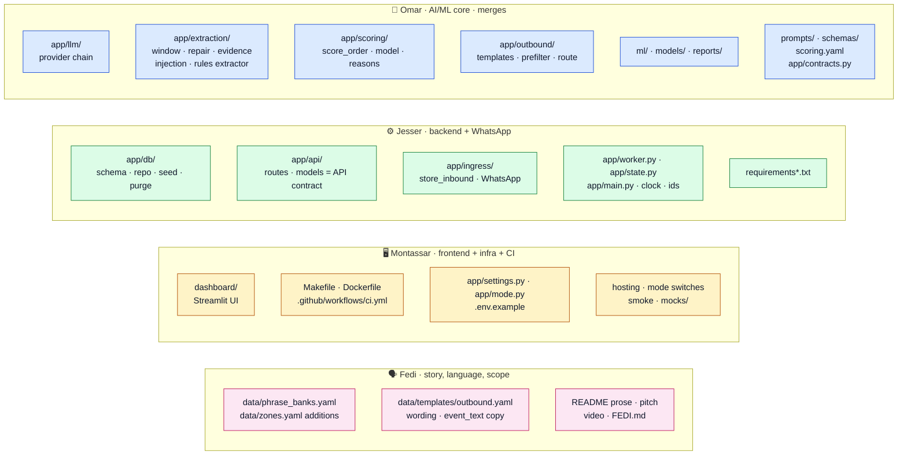
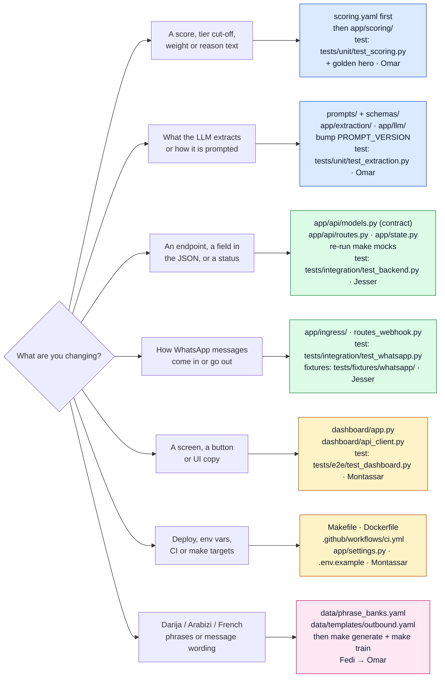
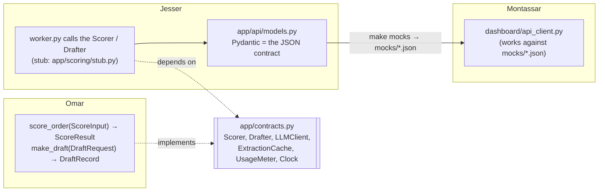
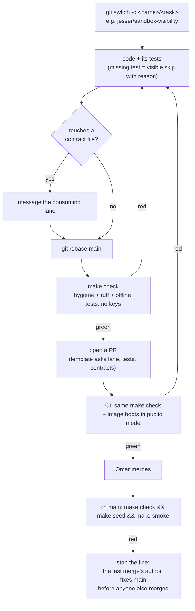
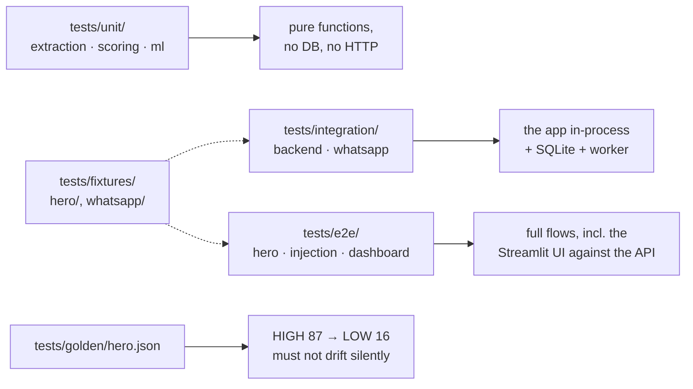

# Team guide: where to work and how

For Z-Team. Use it to find which files a change touches, who owns them, and how to get the change onto `main`. For how the code runs, see [architecture.md](architecture.md). Live status and open points are in [`STATUS.md`](../STATUS.md).

- [1. Who owns what](#1-who-owns-what)
- [2. "I want to change…" → go here](#2-i-want-to-change--go-here)
- [3. How lanes meet: the contracts](#3-how-lanes-meet-the-contracts)
- [4. From branch to `main`](#4-from-branch-to-main)
- [5. Which tests cover what](#5-which-tests-cover-what)
- [6. Day-one setup](#6-day-one-setup)

## 1. Who owns what

Folder = owner. Only the owning lane edits its folders; everyone else asks. Omar merges to `main`. Source: [01 §1](council-spec/01-architecture-contracts.md#1-repository-tree-and-ownership).



The lanes hand work to each other only through the contracts in [§3](#3-how-lanes-meet-the-contracts): Fedi → Omar (phrases, eval windows), Omar → Jesser (`score_order()`, `make_draft()`), Jesser → Montassar (the `/api` JSON and mocks).

## 2. "I want to change…" → go here



Colours match the lanes above: blue Omar, green Jesser, amber Montassar, pink Fedi.

Before you touch a **contract file**, tell the lane that consumes it (see §3).

## 3. How lanes meet: the contracts

Each lane codes against a typed boundary, not against another lane's internals. Stubs and mocks let everyone work before the neighbour is finished.



| Contract file | Owner | Consumer to warn |
|---|---|---|
| `app/contracts.py` | Omar (Jesser reviews) | Jesser |
| `scoring.yaml` | Omar | everyone (the golden test will move) |
| `app/api/models.py`, `mocks/*.json`, `app/db/schema.sql` | Jesser | Montassar |
| `Makefile`, `ci.yml`, `tests/conftest.py` | Montassar | everyone |
| `requirements*.txt` | Jesser | everyone |

## 4. From branch to `main`



Prompt edits have one more rule: bump `PROMPT_VERSION` and rebuild the extraction cache (`make warm`), because the prompt is locked by sha256 in the tests.

## 5. Which tests cover what

`make check` runs all of this offline in under a couple of minutes. Nothing in CI needs an API key; tests marked `live` run only with `RUN_LIVE=1`.



Run one area while you work: `.venv/bin/pytest tests/unit/test_scoring.py -q`. Run `make check` before you push.

## 6. Day-one setup

```bash
git clone https://github.com/omarbounawarapy/hackathon && cd hackathon
make setup          # .venv with pinned deps
make check          # must be green before you change anything
make up             # API :8000 + dashboard :8501, seeded
.venv/bin/python examples/02_customer_reply_rescore.py    # see the core loop from the API
```

Keys are optional. Copy `.env.example` to `.env` and set `GROQ_API_KEY` for live extraction; `.env` is gitignored and `make hygiene` fails if a key-shaped string gets committed.
